# 건강수첩 — 환자용 앱 (MVP)

진료기록을 촬영하거나 PDF로 올리면 AI가 **진단명·검사 수치·처방 약**을 항목별로 정리하고, 어려운 의학 용어를 **환자 눈높이의 쉬운 말**로 풀어 주는 모바일 앱입니다.
검사 수치를 참고치와 비교해 그래프로 보여 주고, 다음 진료 때 물어볼 질문과 여러 기록을 시간순으로 모은 건강 타임라인을 제공합니다.

| 항목 | 내용 |
| --- | --- |
| 계약 건명 | 「2026 PNU 창업동아리」사업화지원 건강수첩 환자용 앱(MVP) 개발 용역 |
| 발주 | 골든타임 (PNU 창업동아리) |
| 수행 | 에스티데브 (STDev) |
| 버전 | 1.0.0 (2026-11, 최초 납품) — [변경 이력](./CHANGELOG.md) |
| 지원 플랫폼 | iOS · Android · 웹(시연용) |

> 발주처로부터 백엔드 API와 디자인을 제공받지 않은 상태에서 수행했습니다. 그래서 앱 안에 **같은 API 계약을 구현한 내장 데모 서버**를 두어 백엔드 없이도 모든 화면을 시연·베타테스트할 수 있게 했고, 실서버는 [제안 API 계약](./docs/API_CONTRACT.md)을 구현하면 환경변수 전환만으로 연동됩니다.

---

## 목차

- [주요 기능](#주요-기능)
- [화면 미리보기](#화면-미리보기)
- [화면 구성](#화면-구성)
- [기술 스택](#기술-스택)
- [실행 방법](#실행-방법)
- [환경변수](#환경변수)
- [백엔드 연동](#백엔드-연동)
- [테스트 빌드 (EAS)](#테스트-빌드-eas)
- [품질 검증](#품질-검증)
- [폴더 구조](#폴더-구조)
- [문서](#문서)
- [라이선스·저작권](#라이선스저작권)

---

## 주요 기능

| 과업 | 세부 과업 (과업지시서) | 구현 내용 |
| --- | --- | --- |
| ① | 문서 등록 | 카메라 촬영·사진 선택(여러 장)·PDF 선택 → 페이지 미리보기·순서 변경·추가/삭제 → 병원명·진료과·진료일·기록 종류 입력 → 업로드 진행률 → AI 처리 단계(글자 인식 → 항목 정리 → 쉬운 해설) 실시간 표시 |
| ② | 구조화 결과 | 기록 요약, 진단명(확진·의심·배제·과거력)·검사 항목·처방 약물(복용법·주의사항)을 항목별 카드로 표시, 항목마다 원문 근거로 이동 |
| ③ | 원문 대조 해설 | 진료기록 원문 문장과 쉬운 해설을 **나란히/위아래**로 대조(아주 좁은 화면·글자 크게 보기의 작은 화면은 자동으로 위아래), 의학 용어 풀이, 신뢰도 낮은 해설에 '의료진 확인 권장' 표시, 구역 필터, 글자 크게 보기 |
| ④ | 검사 수치 시각화 | 참고치 범위 막대 위에 측정값 위치 표시(색+아이콘+글자로 판정), 기록별 검사 수치, 전체 검사 항목 목록, 항목별 수치 변화 그래프·지난 검사 대비 변화 |
| ⑤ | 질문 리스트·건강 타임라인 | AI 추천 질문 저장·직접 작성, '물어봤어요' 체크·답변 메모, 진료실 모드(큰 글씨 전체 화면) / 진료·진단·검사·처방을 월별로 모은 타임라인과 분류 필터 |
| ⑥ | API 연동 | API 계약 인터페이스(`ApiClient`) + HTTP 구현 + 내장 데모 서버, TanStack Query 훅으로 로딩·오류(다시 시도)·빈 상태·처리 중 폴링·자동 재시도·캐시 무효화 일원화 |
| ⑦ | 테스트 빌드·오류 수정 | EAS 빌드 프로필(내부 배포 APK/iOS ad hoc), 개발자 도구(응답 지연·오류율·분석 실패·처리 시간·데이터 초기화), 단위 테스트, [베타테스트 가이드](./docs/BETA_TEST_GUIDE.md) |

과업별 상세 구현·검수 방법은 [납품 내역서](./docs/DELIVERABLES.md)를 참고하세요.

---

## 화면 미리보기

웹 미리보기(390×844)로 캡처한 화면입니다. 표시된 환자·병원은 모두 내장 데모 서버의 **가상 샘플 데이터**입니다. 과업별 전체 캡처와 iOS 시뮬레이터·Android 에뮬레이터 구동 화면은 [납품 내역서](./docs/DELIVERABLES.md#구동-확인--ios-시뮬레이터--android-에뮬레이터)와 [`docs/screenshots/`](./docs/screenshots/) (`web/` · `ios/` · `android/`)에 있습니다.

<table>
<tr>
<td align="center">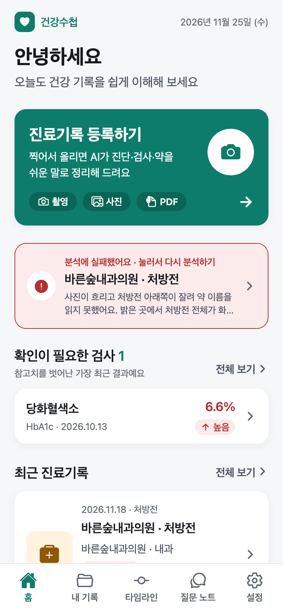<br><sub>홈</sub></td>
<td align="center">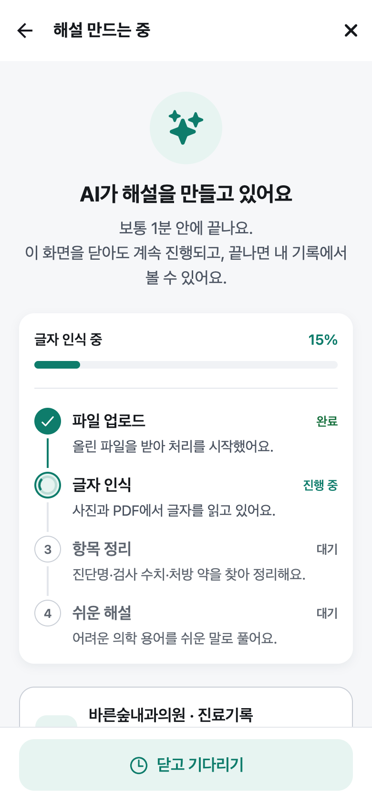<br><sub>① 등록 · AI 처리 단계</sub></td>
<td align="center">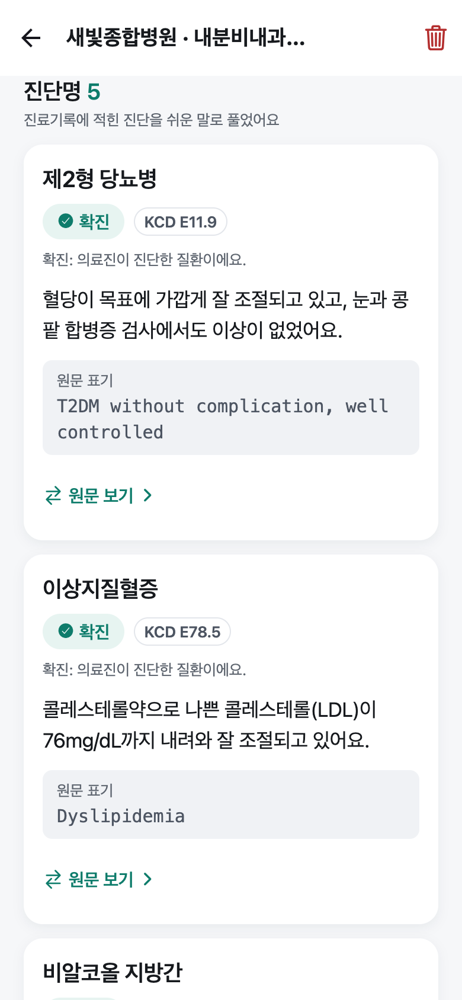<br><sub>② 정리 결과</sub></td>
</tr>
<tr>
<td align="center">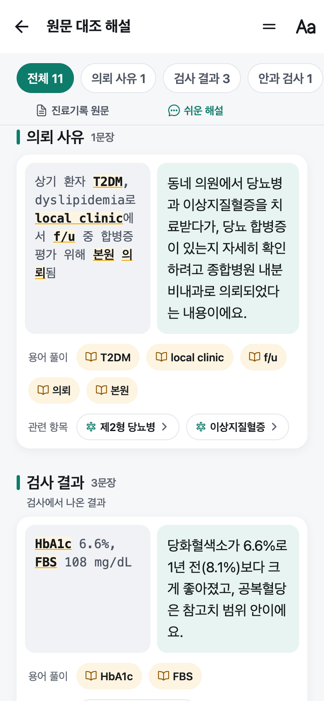<br><sub>③ 원문 대조 해설</sub></td>
<td align="center">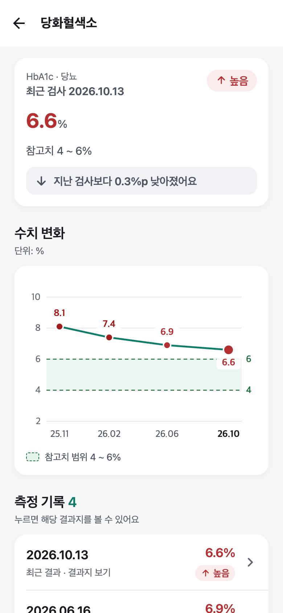<br><sub>④ 검사 수치 변화</sub></td>
<td align="center">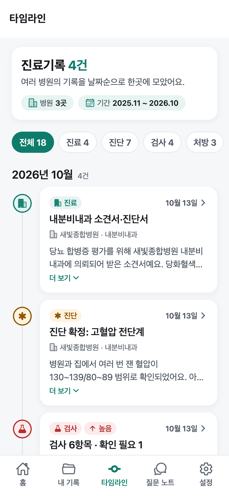<br><sub>⑤ 건강 타임라인</sub></td>
</tr>
</table>

**iOS 시뮬레이터 · Android 에뮬레이터 구동 화면**

<table>
<tr>
<td align="center">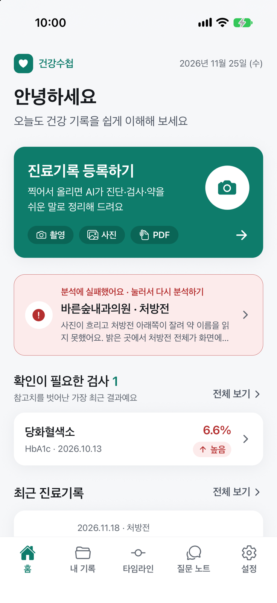<br><sub>iOS · 홈</sub></td>
<td align="center">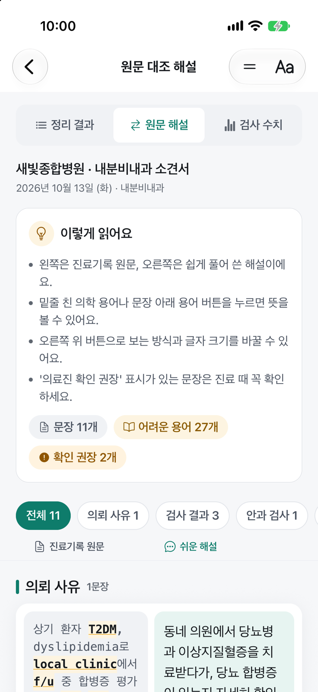<br><sub>iOS · ③ 원문 대조 해설</sub></td>
<td align="center">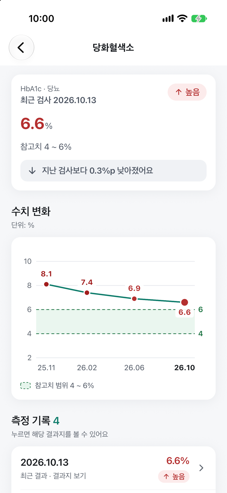<br><sub>iOS · ④ 수치 변화</sub></td>
<td align="center">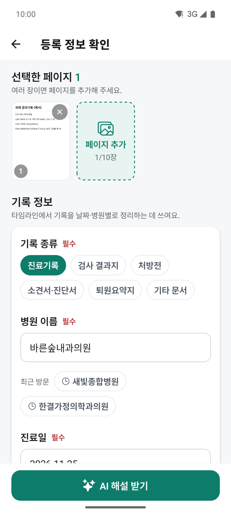<br><sub>Android · ① 정보 입력</sub></td>
<td align="center">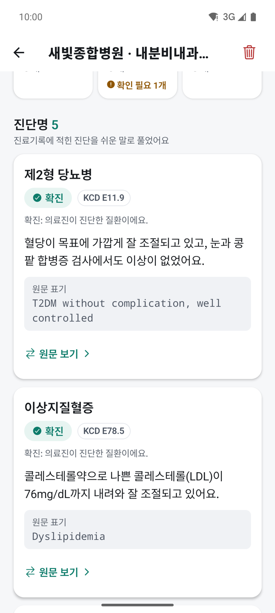<br><sub>Android · ② 정리 결과</sub></td>
<td align="center">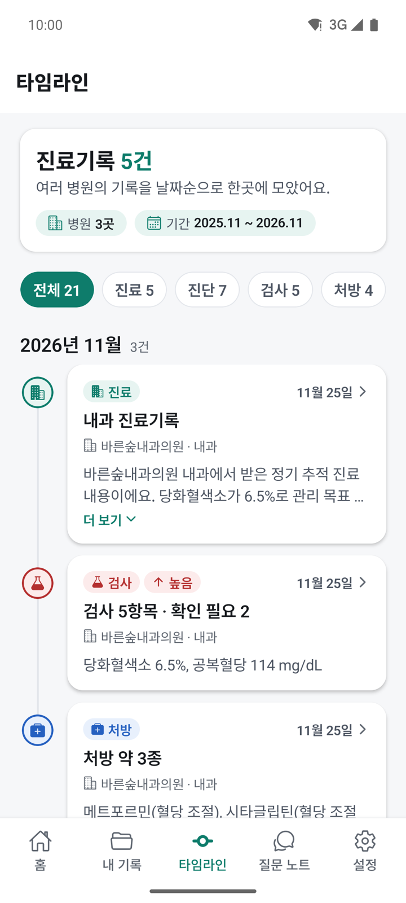<br><sub>Android · ⑤ 타임라인</sub></td>
</tr>
</table>

---

## 화면 구성

파일 기반 라우팅(Expo Router)으로 `src/app/` 의 파일 1개가 화면 1개입니다.

| 경로 (파일) | 화면 | 과업 |
| --- | --- | --- |
| `src/app/onboarding.tsx` | 첫 실행 안내 · AI 해설 고지 및 민감정보 처리 동의 | 공통 |
| `src/app/(tabs)/index.tsx` | **홈** — 등록 바로가기, 처리 상태 알림, 최근 기록, 확인이 필요한 검사, 물어볼 질문 요약 | ①②④⑤ |
| `src/app/(tabs)/records.tsx` | **내 기록** — 진료기록 목록(검색·기록 종류 필터·정렬, 처리 중 진행률) | ①② |
| `src/app/(tabs)/timeline.tsx` | **타임라인** — 진료·진단·검사·처방을 월별로 모은 건강 타임라인 | ⑤ |
| `src/app/(tabs)/questions.tsx` | **질문 노트** — 물어볼/물어본 질문, 진료실 모드 | ⑤ |
| `src/app/(tabs)/settings.tsx` | **설정** — 보기 설정, 서비스 연결 상태, 개발자 도구, 고지·안내 | ⑥⑦ |
| `src/app/upload/index.tsx` | 진료기록 등록 ① 등록 방법 선택 (촬영·사진·PDF) | ① |
| `src/app/upload/review.tsx` | 진료기록 등록 ② 미리보기·기록 정보 입력 → 업로드 | ① |
| `src/app/upload/progress.tsx` | 진료기록 등록 ③ AI 해설 진행 → 완료 요약 / 실패 안내·다시 분석 | ①⑥ |
| `src/app/documents/[id]/index.tsx` | **정리 결과** — 진단명·검사 항목·처방 약물 | ② |
| `src/app/documents/[id]/explanation.tsx` | **원문 대조 해설** | ③ |
| `src/app/documents/[id]/labs.tsx` | **검사 수치** — 기록의 검사 항목을 참고치 막대로 | ④ |
| `src/app/labs/index.tsx` | **내 검사 수치** — 지금까지 측정한 모든 검사 항목 | ④ |
| `src/app/labs/[code].tsx` | **수치 변화** — 항목별 수치 변화 그래프·측정 기록 | ④ |
| `src/app/questions/edit.tsx` | 질문 작성·수정 (모달) | ⑤ |
| `src/app/+not-found.tsx` | 없는 화면 안내 | ⑥ |

---

## 기술 스택

| 영역 | 사용 기술 |
| --- | --- |
| 프레임워크 | Expo SDK 58 (React Native 0.88, React 19.3), TypeScript (strict) |
| 라우팅 | Expo Router 58 — 파일 기반, typed routes |
| 서버 상태 | TanStack Query v5 (`src/hooks/api.ts`) |
| 클라이언트 상태 | Zustand + AsyncStorage 영구 저장 (`src/store/`) |
| 그래픽 | react-native-svg (참고치 막대·수치 변화 그래프) |
| 파일 선택 | expo-image-picker (촬영·사진), expo-document-picker (PDF), expo-file-system (데모 서버 미리보기 보관) |
| 기타 | expo-image, expo-haptics, expo-application (빌드 번호 표시), react-native-reanimated, react-native-gesture-handler |
| 테스트 | Jest 30 + jest-expo, @testing-library/react-native |
| 빌드·배포 | EAS Build (`eas.json`) |

---

## 실행 방법

### 준비물

- Node.js 22.13 이상 또는 24.3 이상 (React Native 0.88 요구사항, 개발 시 Node 24 사용), npm
- 실기기 테스트: [Expo Go](https://expo.dev/go) 앱 (SDK 58 지원 버전) 또는 개발용 빌드
- 시뮬레이터(선택): Xcode(iOS, macOS 전용) / Android Studio(Android 에뮬레이터)

### 설치와 실행

```bash
npm install          # 의존성 설치

npm start            # 개발 서버 실행 (QR 코드 표시)
npm run ios          # iOS 시뮬레이터로 실행
npm run android      # Android 에뮬레이터·연결된 기기로 실행
npm run web          # 웹 브라우저로 실행 (시연용)
```

- 개발 서버 실행 후 터미널에서 `i`(iOS) · `a`(Android) · `w`(웹)를 눌러도 됩니다.
- 처음 실행하면 온보딩(안내 3쪽 + 동의)이 나오고, 내장 데모 서버의 **샘플 진료기록**이 들어 있는 상태로 시작합니다.

### Expo Go 와 개발용 빌드

- 이 앱은 Expo Go 에 포함된 모듈만 사용하므로 **Expo Go 로 바로 실행**할 수 있습니다. 단, 기기에 설치된 Expo Go 가 SDK 58을 지원해야 합니다.
- 스토어의 Expo Go 가 다른 SDK 버전만 지원하면 시뮬레이터용 Expo Go(`npm run ios`/`android` 시 자동 설치)를 쓰거나, EAS 로 만든 **테스트 빌드**(아래)를 설치하세요.
- 네이티브 모듈을 새로 추가하면 Expo Go 대신 개발용 빌드가 필요합니다. 로컬에서는 `npx expo run:ios|android` 를 쓰고, EAS 로 만들려면 `expo-dev-client` 를 설치한 뒤 `developmentClient: true` 프로필을 추가하세요. (`eas.json` 의 `development` 프로필은 개발 서버에 연결하는 dev client 가 아니라 '개발' 환경으로 표시되는 일반 내부 빌드입니다.)

---

## 환경변수

빌드(번들) 시점에 반영되는 공개 환경변수입니다. 정의: `src/api/config.ts`, 예시: [`.env.example`](./.env.example)

| 변수 | 값 | 기본값 | 설명 |
| --- | --- | --- | --- |
| `EXPO_PUBLIC_API_MODE` | `mock` / `http` | `mock` | `mock` = 내장 데모 서버, `http` = 실서버 |
| `EXPO_PUBLIC_API_BASE_URL` | URL | (없음) | 실서버 주소. 개발 빌드에서는 `http` 모드인데 비어 있으면 `mock` 으로 동작. 배포용 빌드(`beta`·`production`)는 비어 있거나 자리표시자(`example.com`)면 시작 화면에 설정 오류를 띄우고 멈춤 |
| `EXPO_PUBLIC_API_TIMEOUT_MS` | 양수(ms) | `20000` | 요청 타임아웃 (업로드는 3배 + 파일 용량에 비례한 전송 시간) |
| `EXPO_PUBLIC_APP_ENV` | `development` / `beta` / `production` | `development` | 빌드 환경 표시 (설정 > 앱 버전). `production` 은 데모 서버(`mock`)로 실행되지 않고, 설정에 API 모드·서버/AI 모델 버전을 표시하지 않음 |
| `EXPO_PUBLIC_SUPPORT_EMAIL` | 메일 주소 | (없음) | 설정 › 정보 › '메일로 문의하기' 받는 주소 (앱 버전이 미리 적힌 메일). 비어 있으면 문의 행을 숨김 — 운영사가 주소를 정하면 `eas.json` 의 `preview`·`production` `env` 에 추가 |

- **로컬 실행** : `.env.example` 을 `.env.local` 로 복사해 값을 바꾼 뒤 개발 서버를 다시 시작합니다 (`npx expo start --clear`). `.env.local` 은 git 에 올라가지 않습니다.
- **EAS 빌드** : `eas.json` 의 각 빌드 프로필 `env` 에 지정합니다 (로컬 `.env.local` 은 클라우드 빌드에 전달되지 않음).
- `EXPO_PUBLIC_` 변수는 앱에 그대로 포함되므로 **비밀 값(API 키 등)을 넣지 마세요.**

---

## 백엔드 연동

화면은 `ApiClient` 인터페이스(`src/api/client.ts`)에만 의존하며, 구현체는 두 가지입니다.

| 구현체 | 위치 | 용도 |
| --- | --- | --- |
| `MockApiClient` | `src/api/mock/` | 내장 데모 서버 — 기기에 데이터 저장, AI 처리 단계를 시간에 따라 진행, 지연·오류 주입 |
| `HttpApiClient` | `src/api/http-client.ts` | 실서버 REST 연동 — 래핑 응답 허용, 오류를 `ApiError` 로 정규화, 업로드 진행률 |

**실서버로 전환하기**

1. 백엔드가 [API 계약서](./docs/API_CONTRACT.md) (기계 판독용 [`docs/openapi.yaml`](./docs/openapi.yaml))를 구현합니다.
2. 환경변수를 설정합니다.
   ```bash
   EXPO_PUBLIC_API_MODE=http
   EXPO_PUBLIC_API_BASE_URL=https://api.example.com
   ```
3. 앱을 다시 실행하거나 빌드합니다. 설정 > 서비스 연결에서 'API 모드: 실서버'와 연결 상태(`GET /health`)를 확인합니다. (API 모드와 서버·AI 모델 버전은 개발·베타 빌드와 내장 데모 서버에서만 보이고, 정식(`production`) 빌드는 연결 상태만 보여 줍니다.)

백엔드가 계약과 다른 형태라면 화면 코드는 그대로 두고 `src/api/http-client.ts` 의 경로·필드 매핑만 수정합니다 (인증 토큰은 `src/api/index.ts` 에서 `getAuthToken` 주입).

---

## 테스트 빌드 (EAS)

[EAS Build](https://docs.expo.dev/build/introduction/)로 클라우드에서 설치 파일을 만듭니다. 절차·설치·시연 시나리오는 [베타테스트 가이드](./docs/BETA_TEST_GUIDE.md)를 참고하세요.

| 프로필 (`eas.json`) | 배포 | API | 용도 |
| --- | --- | --- | --- |
| `development` | 내부 배포 | 데모 서버 | '개발' 환경으로 표시되는 일반 내부 빌드 (dev client 아님) |
| `preview` | 내부 배포 (Android APK) | 데모 서버 | **베타테스트·시연** (백엔드 불필요), 빌드 번호 자동 증가 — 설정 › 정보 › 앱 버전에 `1.0.0 (7)` 처럼 표시 |
| `preview-api` | 내부 배포 (Android APK) | 실서버 | 백엔드 연동 베타테스트 — `EXPO_PUBLIC_API_BASE_URL` 을 실제 주소로 교체 후 사용 |
| `production` | 스토어 제출용 | 실서버 | 정식 출시 — 주소 교체 필수, 빌드 번호 자동 증가 |

```bash
npm install -g eas-cli      # 최초 1회 (또는 npx eas-cli@latest …)
eas login                   # Expo 계정 로그인

npm run build:preview:android   # = eas build --profile preview --platform android
npm run build:preview:ios       # = eas build --profile preview --platform ios (Apple Developer 계정·기기 등록 필요)
```

> `preview-api`·`production` 프로필의 `https://api.example.com` 은 자리표시자입니다. 실서버 주소로 바꾼 뒤 빌드하세요. 그대로 빌드하면 앱이 '서비스 연결 설정이 필요해요' 화면에서 멈춥니다 (`src/api/config.ts`).
> 무선 업데이트(`expo-updates`)는 사용하지 않습니다. 베타테스트 중 오류 수정은 다시 빌드해 배포합니다 ([베타테스트 가이드 1.7](./docs/BETA_TEST_GUIDE.md#17-테스트-기간-중-오류-수정-배포)).
> 스토어 제출·서명 키·Apple/Google 개발자 계정은 발주처 명의로 준비해야 합니다.

---

## 품질 검증

```bash
npm run typecheck   # TypeScript 타입 검사 (tsc --noEmit)
npm run lint        # ESLint (expo lint)
npm test            # Jest 단위 테스트
npm run verify      # 위 세 가지를 차례로 실행
npm run doctor      # 의존성·설정 진단 (npx expo-doctor@latest)
```

- 타입 검사는 생성 파일(`.expo/types`, `expo-env.d.ts`) 없이도 통과합니다 — 새로 받은 저장소에서 `npm install` 후 바로 `npm run verify` 를 실행할 수 있습니다.
- 테스트 범위: API 계층(HTTP 클라이언트·오류 정규화·설정), 내장 데모 서버(문서 처리 파이프라인·질문·검사 집계·타임라인·영구 저장), 유틸(날짜·검사 수치 계산·라벨), 스토어, 화면별 로직·컴포넌트.

---

## 폴더 구조

```
src/
  app/                  화면(라우트) — (tabs) · upload · documents/[id] · labs · questions · onboarding
  api/                  API 계약(client.ts) · HTTP 구현 · 오류 정규화 · 설정 · 내장 데모 서버(mock/)
  components/
    ui/                 공통 UI (AppText, Button, Card, Badge, Chip, ChoiceChips, HeaderButton, SegmentedTabs, TextField, Screen …)
    states/             로딩 · 오류 · 빈 상태, QueryState
    domain/             공유 도메인 컴포넌트 (DocumentGate, LabFlagBadge, AiDisclaimer …)
    upload/ result/ explanation/ labs/ questions/ timeline/ home/ records/ settings/ onboarding/
                        화면별 전용 컴포넌트
  constants/theme.ts    디자인 토큰 (색상 · 간격 · 글꼴)
  hooks/                서버 데이터 훅 api.ts (TanStack Query) · 당겨서 새로고침 · 오늘 날짜
  lib/                  순수 함수 유틸 (날짜 · 검사 수치 · 라벨 · 아이콘 · 대화상자 · 햅틱 · 파일 선택)
  store/                Zustand 스토어 (설정 · 진료기록 등록 임시 상태)
  types/domain.ts       도메인 타입 (API 응답 스키마와 1:1)
assets/                 앱 아이콘 · 스플래시
docs/                   개발 가이드 · API 계약 · 납품 내역 · 베타테스트 가이드
```

코드 컨벤션과 확장 규칙은 [개발 가이드](./docs/DEVELOPMENT.md)를 따릅니다.

---

## 문서

| 문서 | 내용 |
| --- | --- |
| [docs/DELIVERABLES.md](./docs/DELIVERABLES.md) | 납품 내역서 — 과업별 구현·검수 방법, 납품물 목록, 검수 체크리스트 |
| [docs/API_CONTRACT.md](./docs/API_CONTRACT.md) | API 계약서 (제안안) — 엔드포인트·스키마·오류·처리 상태 |
| [docs/openapi.yaml](./docs/openapi.yaml) | OpenAPI 3.1 명세 |
| [docs/BETA_TEST_GUIDE.md](./docs/BETA_TEST_GUIDE.md) | 테스트 빌드·설치·시연 시나리오·오류 제보 양식 |
| [docs/DEVELOPMENT.md](./docs/DEVELOPMENT.md) | 개발 가이드 (코드 컨벤션) |
| [CHANGELOG.md](./CHANGELOG.md) | 변경 이력 |

---

## 라이선스·저작권

- 본 소스코드와 문서 등 **납품물의 권리 귀속과 이용 범위는 용역 계약서에 따릅니다.**
- 앱이 사용하는 오픈소스 라이브러리(Expo, React Native 등)는 각 라이브러리의 라이선스(MIT 등)를 따르며, 목록은 `package.json` 과 `node_modules/*/LICENSE` 에서 확인할 수 있습니다.
- 앱의 AI 해설은 참고 자료이며 의학적 진단·처방을 대신하지 않습니다. 실제 환자 데이터로 운영하기 전에 인증, 개인정보(민감정보) 보호 조치와 관련 법령 검토가 필요합니다.
