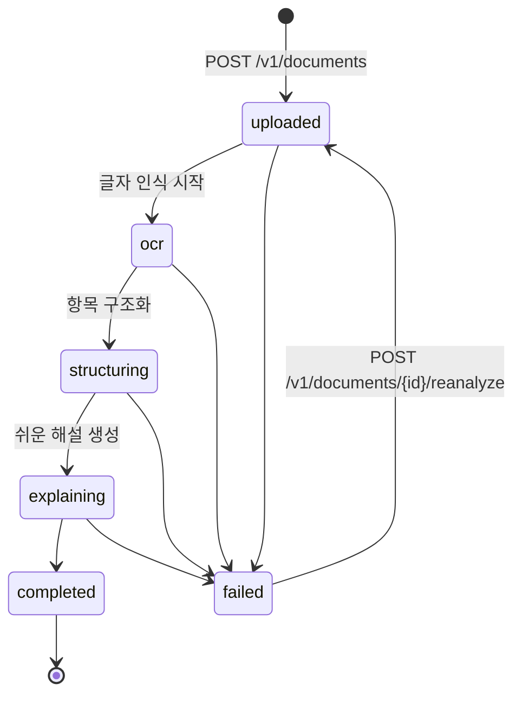

# 건강수첩 API 계약서 (제안안)

| 항목 | 내용 |
| --- | --- |
| 문서 버전 | v1.0.0 (2026-11) |
| 대상 | 건강수첩 환자용 앱(MVP) ↔ 창업동아리 백엔드·AI 해설 API |
| 기계 판독용 명세 | [`docs/openapi.yaml`](./openapi.yaml) (OpenAPI 3.1) |
| 앱 쪽 기준 코드 | `src/api/client.ts`(계약 인터페이스) · `src/api/http-client.ts`(HTTP 구현) · `src/types/domain.ts`(스키마) · `src/api/errors.ts`(오류 코드) |
| 참조 구현 | `src/api/mock/mock-client.ts` — 앱에 내장된 데모 서버가 이 계약을 그대로 구현합니다 |

> **이 문서의 성격**
> 용역 수행 시점에 발주처로부터 API 명세를 제공받지 못해, 수행사가 앱 화면에 필요한 데이터를 기준으로 **제안하는 API 계약**입니다.
> 창업동아리 백엔드가 이 계약대로 구현하면 앱은 환경변수만 바꿔 바로 연동됩니다.
> 백엔드가 다른 형태로 이미 구현되어 있다면 화면 코드는 그대로 두고 `src/api/http-client.ts` 의 경로·필드 매핑만 고치면 됩니다 (화면은 `ApiClient` 인터페이스에만 의존).

---

## 목차

1. [공통 규칙](#1-공통-규칙)
2. [오류 응답](#2-오류-응답)
3. [엔드포인트 요약](#3-엔드포인트-요약)
4. [엔드포인트 상세](#4-엔드포인트-상세)
5. [문서 처리 상태와 폴링](#5-문서-처리-상태와-폴링)
6. [데이터 모델](#6-데이터-모델)
7. [연동 절차와 백엔드 체크리스트](#7-연동-절차와-백엔드-체크리스트)

---

## 1. 공통 규칙

### 1.1 기본 주소와 경로

- 기본 주소(Base URL)는 빌드 환경변수 `EXPO_PUBLIC_API_BASE_URL` 로 지정합니다 (예: `https://api.example.com`). 끝의 `/` 는 앱이 제거합니다.
- 리소스 경로는 `/v1` 접두사를 사용합니다. 상태 확인만 `/health` 입니다.
- 경로 파라미터(`{id}`, `{code}`)는 앱이 URL 인코딩(`encodeURIComponent`)해서 보냅니다. ID는 영문·숫자·`_`·`-` 조합을 권장합니다.

### 1.2 형식

| 항목 | 규칙 |
| --- | --- |
| 본문 | JSON (UTF-8). 문서 업로드만 `multipart/form-data` |
| 필드 이름 | camelCase (예: `visitDate`, `labResults`) |
| 날짜 (`DateString`) | `YYYY-MM-DD` — 진료일·검사일처럼 날짜만 의미 있는 값 |
| 시각 (`IsoDateTime`) | ISO 8601, UTC 권장 (예: `2026-11-20T01:12:30.000Z`) — 생성·수정 시각 |
| 선택 필드 | 값이 없으면 **필드를 생략**합니다 (`null` 대신 생략 권장) |
| 숫자 | 검사 수치·참고치는 JSON number (문자열 금지) |

### 1.3 요청 헤더

| 헤더 | 값 | 비고 |
| --- | --- | --- |
| `Accept` | `application/json` | 모든 요청 |
| `X-Client` | `health-note-app/1.0.0` | 모든 요청 — 클라이언트 식별·로그용 |
| `Content-Type` | `application/json` | JSON 본문이 있는 요청 (`POST /v1/questions`, `PATCH /v1/questions/{id}`) |
| `Content-Type` | `multipart/form-data; boundary=…` | 문서 업로드 — 경계값은 런타임이 자동 지정 |
| `Authorization` | `Bearer {token}` | **선택.** 인증 도입 시 `HttpApiClient` 의 `getAuthToken` 옵션으로 주입 (아래 7.2 참고) |

> MVP 과업 범위에는 회원·인증 기능이 포함되어 있지 않습니다. 실제 환자 데이터를 다루기 전에는 반드시 인증과 사용자별 데이터 분리를 도입해야 합니다.

### 1.4 성공 응답 형식 (래핑 허용)

앱은 아래 세 형식을 모두 해석합니다 (`unwrapEnvelope`).

```jsonc
// ① 리소스 그대로 (권장)
[{ "id": "doc_8f2k1", "title": "부산내과의원 · 진료기록" }]

// ② data 래핑
{ "data": [{ "id": "doc_8f2k1", "title": "부산내과의원 · 진료기록" }] }

// ③ data + meta(·links·pagination) 래핑
{ "data": [{ "id": "doc_8f2k1" }], "meta": { "total": 1 } }
```

최상위 키가 `data`(와 `meta`·`links`·`pagination`)뿐일 때만 래핑으로 판단합니다. 그 밖의 키가 함께 있으면 리소스 자체로 봅니다.
목록 응답이 배열이 아니거나 단건 응답이 객체가 아니면 앱은 `SERVER` 오류(다시 시도 안내)로 처리합니다.
`DELETE` 요청은 `204 No Content` 또는 본문이 있는 `200` 모두 허용합니다 (본문은 사용하지 않음).

### 1.5 타임아웃과 자동 재시도 (앱 동작)

| 구분 | 값 | 설명 |
| --- | --- | --- |
| 일반 요청 타임아웃 | `EXPO_PUBLIC_API_TIMEOUT_MS` (기본 20,000ms) | 초과 시 요청을 중단하고 `TIMEOUT` 오류 |
| 업로드 타임아웃 | 일반 타임아웃 × 3 + 파일 용량 ÷ 128KB/s | 느린 회선(약 1Mbps)에서도 큰 업로드가 끝까지 전송되도록 용량에 비례 (예: 사진 10장 35MB ≈ 5분) |
| 조회 자동 재시도 | 최대 2회 | `NETWORK`·`TIMEOUT`·`RATE_LIMITED`·`SERVER` 오류만. 404·검증 오류는 즉시 오류 화면 |
| 변경 요청 재시도 | 없음 | 등록·수정·삭제는 자동 재시도하지 않음 (중복 생성 방지). 사용자가 직접 '다시 시도'한 업로드는 같은 `Idempotency-Key` 를 보냄 (4.3) |
| 캐시 유지 | 조회 30초, 해설 5분, 질문 추천 1분 | 이 시간 안에는 같은 화면 재진입 시 다시 요청하지 않음 |

---

## 2. 오류 응답

### 2.1 형식

```json
{
  "error": {
    "code": "VALIDATION",
    "message": "병원 이름을 입력해 주세요."
  }
}
```

- `code` : 아래 표의 오류 코드 중 하나. 표에 없는 값이면 앱은 HTTP 상태 코드로 판단합니다.
- `message` : 사람이 읽을 수 있는 설명.
  - **`VALIDATION` 오류의 `message` 는 환자에게 그대로 표시**되므로 환자 눈높이의 해요체 한국어로 작성해 주세요.
  - 그 밖의 오류는 앱이 준비한 안내 문구를 표시하고 `message` 는 로그용으로만 사용합니다.
- 최상위에 `{ "message": "..." }` 만 있는 형식도 허용합니다.

### 2.2 오류 코드

| 코드 | HTTP 상태 | 의미 | 앱 안내 문구 (기본) | 자동 재시도 |
| --- | --- | --- | --- | --- |
| `VALIDATION` | 400, 422 | 입력값 오류 | 서버 `message` (없으면 "입력한 내용을 다시 확인해 주세요.") | ✕ |
| `UNAUTHORIZED` | 401, 403 | 인증·권한 없음 | 접근 권한이 없어요. 앱을 다시 실행해 주세요. | ✕ |
| `NOT_FOUND` | 404 | 리소스 없음 / 해설 준비 전 | 요청한 정보를 찾을 수 없어요. 삭제되었을 수 있어요. | ✕ |
| `ANALYSIS_FAILED` | 409 (권장) | AI 해설 파이프라인 실패 | 문서를 분석하지 못했어요. 더 선명한 사진으로 다시 등록해 주세요. | ✕ |
| `PAYLOAD_TOO_LARGE` | 413 | 업로드 용량 초과 | 파일 용량이 너무 커요. 페이지 수를 줄이거나 화질을 낮춰 주세요. | ✕ |
| `RATE_LIMITED` | 429 | 요청 과다 | 요청이 많아 잠시 대기 중이에요. 잠시 후 다시 시도해 주세요. | ○ |
| `TIMEOUT` | 408 / (앱) | 응답 지연 | 서버 응답이 늦어지고 있어요. 잠시 후 다시 시도해 주세요. | ○ |
| `SERVER` | 5xx | 서버 내부 오류 | 서버에 일시적인 문제가 있어요. 잠시 후 다시 시도해 주세요. | ○ |
| `NETWORK` | (앱) | 네트워크 연결 실패 | 인터넷 연결을 확인한 뒤 다시 시도해 주세요. | ○ |
| `UNKNOWN` | 그 밖의 상태 | 분류되지 않은 오류 | 알 수 없는 오류가 발생했어요. 잠시 후 다시 시도해 주세요. | ✕ |

`(앱)` 표시는 서버가 보내지 않고 앱이 스스로 판단하는 코드입니다. `ANALYSIS_FAILED` 는 HTTP 상태로는 추론할 수 없으므로 반드시 본문의 `error.code` 로 보내 주세요.

---

## 3. 엔드포인트 요약

| # | 메서드 | 경로 | 설명 | 앱 메서드 (`ApiClient`) | 관련 과업 |
| --- | --- | --- | --- | --- | --- |
| 1 | GET | `/health` | 서버·AI 모델 상태 | `health()` | ⑥ |
| 2 | GET | `/v1/documents` | 문서 목록 (진료일 최신순) | `listDocuments()` | ①⑤ |
| 3 | POST | `/v1/documents` | 문서 등록 (multipart) | `uploadDocument()` | ① |
| 4 | GET | `/v1/documents/{id}` | 문서 단건 · 처리 상태 폴링 | `getDocument()` | ①② |
| 5 | DELETE | `/v1/documents/{id}` | 문서 삭제 | `deleteDocument()` | ② |
| 6 | POST | `/v1/documents/{id}/reanalyze` | 실패 문서 재분석 | `reanalyzeDocument()` | ①⑥ |
| 7 | GET | `/v1/documents/{id}/analysis` | 구조화 결과 + 원문 대조 해설 | `getAnalysis()` | ②③④ |
| 8 | POST | `/v1/documents/{id}/question-suggestions` | AI 질문 추천 (저장 안 함) | `suggestQuestions()` | ⑤ |
| 9 | GET | `/v1/labs` | 측정 이력이 있는 검사 항목 목록 | `listLabCatalog()` | ④ |
| 10 | GET | `/v1/labs/{code}/trend` | 검사 항목별 추이 | `getLabTrend()` | ④ |
| 11 | GET | `/v1/questions` | 질문 목록 (`?documentId=`) | `listQuestions()` | ⑤ |
| 12 | POST | `/v1/questions` | 질문 등록 | `createQuestion()` | ⑤ |
| 13 | PATCH | `/v1/questions/{id}` | 질문 수정 (물어봄 체크·답변 메모) | `updateQuestion()` | ⑤ |
| 14 | DELETE | `/v1/questions/{id}` | 질문 삭제 | `deleteQuestion()` | ⑤ |
| 15 | GET | `/v1/timeline` | 건강 타임라인 (날짜 최신순) | `getTimeline()` | ⑤ |

---

## 4. 엔드포인트 상세

### 4.1 `GET /health` — 서버 상태

설정 화면의 '연결 상태'에 표시됩니다. 자동 재시도하지 않습니다.

**200 응답** — [`HealthStatus`](#healthstatus)

```json
{
  "ok": true,
  "version": "1.0.0",
  "modelVersion": "health-note-explainer-2026.11"
}
```

`ok: false` 를 보내면 앱은 '점검 중'으로 표시합니다.

---

### 4.2 `GET /v1/documents` — 문서 목록

**정렬** : 진료일(`visitDate`) 내림차순, 같은 날이면 등록 시각(`createdAt`) 내림차순.

**200 응답** — [`MedicalDocument`](#medicaldocument)`[]`

```json
[
  {
    "id": "doc_8f2k1",
    "title": "부산내과의원 · 진료기록",
    "documentType": "medical_record",
    "hospitalName": "부산내과의원",
    "department": "내분비내과",
    "visitDate": "2026-11-20",
    "source": "camera",
    "pageCount": 2,
    "thumbnailUri": "https://cdn.example.com/documents/doc_8f2k1/page-1-thumb.jpg",
    "status": "completed",
    "progress": 100,
    "summary": {
      "diagnosisCount": 2,
      "labCount": 3,
      "abnormalLabCount": 2,
      "medicationCount": 1
    },
    "createdAt": "2026-11-20T01:12:30.000Z",
    "updatedAt": "2026-11-20T01:12:41.000Z"
  },
  {
    "id": "doc_9a7c3",
    "title": "해운대검진센터 · 검사 결과지",
    "documentType": "lab_result",
    "hospitalName": "해운대검진센터",
    "visitDate": "2026-11-18",
    "source": "pdf",
    "pageCount": 1,
    "status": "ocr",
    "progress": 28,
    "createdAt": "2026-11-24T02:00:00.000Z",
    "updatedAt": "2026-11-24T02:00:04.000Z"
  }
]
```

목록에 처리 중 문서가 있으면 앱은 3초마다 목록을 다시 조회합니다.

---

### 4.3 `POST /v1/documents` — 문서 등록

진료기록 사진(촬영·앨범) 또는 PDF를 업로드합니다. 업로드 진행률 표시를 위해 앱은 `XMLHttpRequest` 로 전송합니다.

**요청** — `multipart/form-data`

| 파트 이름 | 개수 | 형식 | 설명 |
| --- | --- | --- | --- |
| `files` | 1~10개 (같은 이름 반복) | 파일 | 페이지 순서대로 전송. 사진 1장 = 1파트, PDF 1개 = 1파트 |
| `metadata` | 1개 | 문자열(JSON) | 아래 `metadata` 객체를 `JSON.stringify` 한 값 |

- `files` 파트의 `Content-Type` : `image/jpeg`, `image/png`, `image/heic`, `image/heif`, `image/webp`, `application/pdf`
- 요청 헤더 `Idempotency-Key` : 앱이 등록 내용(파일·문서 정보)으로 만든 중복 방지 키 (예: `upload-3f9a0c1e7b2d4a56`). 사용자가 같은 등록을 '다시 시도'하면 같은 키가 갑니다. 서버는 24시간 안에 같은 키로 다시 받은 요청에 **새 문서를 만들지 말고 처음 만든 문서를 그대로 응답**해 주세요 (첫 요청은 도착했지만 응답이 늦어 앱이 시간 초과로 실패한 경우의 중복 등록 방지). 지원하지 않으면 무시해도 됩니다.
- 앱 측 제한 : 한 문서 최대 **10페이지**, 파일당 최대 **20MB** (선택 단계에서 초과분 제외). 서버도 동일하게 검증하고 초과 시 `413` 으로 응답해 주세요.

`metadata` 객체 — [`UploadDocumentInput`](#uploaddocumentinput) 에서 `files` 를 뺀 값

```json
{
  "source": "camera",
  "documentType": "medical_record",
  "hospitalName": "부산내과의원",
  "department": "내분비내과",
  "visitDate": "2026-11-20",
  "title": "11월 정기 진료"
}
```

| 필드 | 필수 | 설명 |
| --- | --- | --- |
| `source` | ✓ | `camera` / `gallery` / `pdf` |
| `documentType` | ✓ | [`DocumentType`](#열거형) |
| `hospitalName` | ✓ | 앞뒤 공백 제거 후 1~40자 |
| `department` | | 진료과, 최대 20자. 비어 있으면 생략 |
| `visitDate` | ✓ | `YYYY-MM-DD` |
| `title` | | 최대 60자. 비어 있으면 서버가 `{병원명} · {문서 종류 라벨}` 로 생성 (예: `부산내과의원 · 진료기록`) |

글자 수 제한은 앱 입력 화면과 같은 기준입니다. 초과하면 `422` `VALIDATION` 으로 응답해 주세요.

**201 응답** (2xx 모두 허용) — 등록된 [`MedicalDocument`](#medicaldocument). 처리는 비동기로 진행되므로 `status` 는 보통 `uploaded` 입니다.

```json
{
  "id": "doc_b41d0",
  "title": "11월 정기 진료",
  "documentType": "medical_record",
  "hospitalName": "부산내과의원",
  "department": "내분비내과",
  "visitDate": "2026-11-20",
  "source": "camera",
  "pageCount": 2,
  "thumbnailUri": "https://cdn.example.com/documents/doc_b41d0/page-1-thumb.jpg",
  "status": "uploaded",
  "progress": 5,
  "createdAt": "2026-11-24T02:10:00.000Z",
  "updatedAt": "2026-11-24T02:10:00.000Z"
}
```

| 상태 | 코드 | 예시 `message` |
| --- | --- | --- |
| 400 / 422 | `VALIDATION` | `등록할 파일을 선택해 주세요.` / `병원 이름을 입력해 주세요.` / `지원하지 않는 파일 형식이에요.` |
| 413 | `PAYLOAD_TOO_LARGE` | (앱 기본 문구 표시) |

> `thumbnailUri` 는 앱이 바로 표시할 수 있는 이미지 URL이어야 합니다 (인증이 필요하면 서명된 URL 권장). PDF는 생략할 수 있습니다.

---

### 4.4 `GET /v1/documents/{id}` — 문서 단건 · 처리 상태

문서 상세 화면 진입과 **처리 상태 폴링**에 사용합니다. 처리 상태 규칙은 [5장](#5-문서-처리-상태와-폴링)을 참고하세요.

**200 응답** — [`MedicalDocument`](#medicaldocument)

처리 실패 예시:

```json
{
  "id": "doc_c55e2",
  "title": "부산내과의원 · 처방전",
  "documentType": "prescription",
  "hospitalName": "부산내과의원",
  "visitDate": "2026-11-21",
  "source": "gallery",
  "pageCount": 1,
  "thumbnailUri": "https://cdn.example.com/documents/doc_c55e2/page-1-thumb.jpg",
  "status": "failed",
  "progress": 40,
  "failureReason": "사진에서 글자를 충분히 인식하지 못했어요. 그림자나 흔들림 없이 문서 전체가 보이도록 다시 촬영해 주세요.",
  "createdAt": "2026-11-24T02:20:00.000Z",
  "updatedAt": "2026-11-24T02:20:07.000Z"
}
```

| 상태 | 코드 | 설명 |
| --- | --- | --- |
| 404 | `NOT_FOUND` | 없는 문서 |

---

### 4.5 `DELETE /v1/documents/{id}` — 문서 삭제

**204 응답** (또는 200)

서버 처리 규칙:

- 문서와 해설(analysis)을 삭제하고, 검사 항목 목록·추이·타임라인에서도 제외합니다.
- 이 문서에서 나온 **질문은 삭제하지 않고** `documentId` 연결만 해제합니다 (환자가 적어 둔 질문 보존).

| 상태 | 코드 | 설명 |
| --- | --- | --- |
| 404 | `NOT_FOUND` | 없는 문서 |

---

### 4.6 `POST /v1/documents/{id}/reanalyze` — 실패 문서 재분석

요청 본문 없음. `status === "failed"` 인 문서만 다시 분석합니다.

**200 응답** — [`MedicalDocument`](#medicaldocument) (`status: "uploaded"`, `failureReason` 제거)

```json
{
  "id": "doc_c55e2",
  "title": "부산내과의원 · 처방전",
  "documentType": "prescription",
  "hospitalName": "부산내과의원",
  "visitDate": "2026-11-21",
  "source": "gallery",
  "pageCount": 1,
  "status": "uploaded",
  "progress": 5,
  "createdAt": "2026-11-24T02:20:00.000Z",
  "updatedAt": "2026-11-24T02:25:00.000Z"
}
```

| 상태 | 코드 | 예시 `message` |
| --- | --- | --- |
| 422 | `VALIDATION` | `분석에 실패한 진료기록만 다시 분석할 수 있어요.` |
| 404 | `NOT_FOUND` | 없는 문서 |

---

### 4.7 `GET /v1/documents/{id}/analysis` — 구조화 결과 · 원문 대조 해설

진단명·검사 수치·처방 약(과업 ②), 원문 문장별 쉬운 해설(과업 ③), 참고치 비교(과업 ④)의 원천 데이터입니다.

**가용성 규칙**

| 문서 상태 | 응답 |
| --- | --- |
| `completed` | **200** + [`DocumentAnalysis`](#documentanalysis) |
| `uploaded` · `ocr` · `structuring` · `explaining` | **404** `NOT_FOUND` (해설 준비 전) |
| `failed` | **409** `ANALYSIS_FAILED` |
| 문서 없음 | **404** `NOT_FOUND` |

앱은 문서가 `completed` 가 된 뒤에만 이 API를 호출합니다.

**200 응답** — [`DocumentAnalysis`](#documentanalysis)

```json
{
  "documentId": "doc_8f2k1",
  "generatedAt": "2026-11-20T01:12:41.000Z",
  "modelVersion": "health-note-explainer-2026.11",
  "overallSummary": "당뇨병 정기 진료 기록이에요. 최근 2~3개월 평균 혈당을 보여 주는 당화혈색소가 7.4%로 목표보다 높아 약을 계속 드시면서 식사·운동 관리가 필요하다는 내용이에요. 콜레스테롤이 높을 가능성이 있어 다음 진료 때 다시 확인할 예정이에요.",
  "diagnoses": [
    {
      "id": "dx_1",
      "name": "제2형 당뇨병",
      "originalTerm": "Type 2 DM, uncontrolled",
      "code": "E11.9",
      "status": "confirmed",
      "plainExplanation": "몸에서 인슐린이 제대로 작용하지 않아 혈당이 높게 유지되는 병이에요. 꾸준한 약 복용과 생활 습관 관리로 조절할 수 있어요.",
      "sentenceIds": ["s_1"]
    },
    {
      "id": "dx_2",
      "name": "이상지질혈증",
      "originalTerm": "r/o Dyslipidemia",
      "code": "E78.5",
      "status": "suspected",
      "plainExplanation": "혈액 속 콜레스테롤 같은 기름 성분이 많은 상태일 수 있어요. 아직 확진은 아니고 추가 검사로 확인해요.",
      "sentenceIds": ["s_4"]
    }
  ],
  "labResults": [
    {
      "id": "lab_1",
      "code": "HBA1C",
      "name": "당화혈색소",
      "originalName": "HbA1c",
      "category": "당뇨",
      "value": 7.4,
      "unit": "%",
      "referenceRange": { "low": 4.0, "high": 6.0, "text": "4.0-6.0" },
      "flag": "high",
      "measuredAt": "2026-11-20",
      "plainExplanation": "최근 2~3개월 동안의 평균 혈당을 보여 주는 수치예요. 기준보다 높아 혈당 관리가 더 필요해요.",
      "sentenceIds": ["s_2"]
    },
    {
      "id": "lab_2",
      "code": "GLU_FASTING",
      "name": "공복 혈당",
      "originalName": "FBS",
      "category": "당뇨",
      "value": 110,
      "unit": "mg/dL",
      "referenceRange": { "low": 70, "high": 99, "text": "70-99" },
      "flag": "high",
      "measuredAt": "2026-11-20",
      "plainExplanation": "8시간 이상 굶은 뒤 잰 혈당이에요. 기준보다 조금 높아요.",
      "sentenceIds": ["s_2"]
    },
    {
      "id": "lab_3",
      "code": "EGFR",
      "name": "사구체여과율(콩팥 기능)",
      "originalName": "eGFR",
      "category": "신장기능",
      "value": 92,
      "unit": "mL/min/1.73m²",
      "referenceRange": { "low": 60, "text": "≥60" },
      "flag": "normal",
      "measuredAt": "2026-11-20",
      "plainExplanation": "콩팥이 노폐물을 걸러 내는 능력이에요. 정상 범위예요.",
      "sentenceIds": ["s_2"]
    }
  ],
  "medications": [
    {
      "id": "rx_1",
      "name": "다이아벡스정 500mg",
      "ingredient": "메트포르민",
      "originalText": "Metformin 500mg 1T bid pc",
      "dose": "1정",
      "frequency": "하루 2번, 아침·저녁 식사 직후",
      "durationDays": 90,
      "purpose": "혈당 조절",
      "cautions": [
        "속이 메스껍거나 설사가 날 수 있어요. 식사 직후에 드시면 줄어들어요.",
        "조영제를 쓰는 검사(CT 등) 전에는 의료진에게 이 약을 먹고 있다고 알려 주세요."
      ],
      "sentenceIds": ["s_3"]
    }
  ],
  "sentences": [
    {
      "id": "s_1",
      "order": 1,
      "section": "진단",
      "original": "Type 2 DM, uncontrolled",
      "plain": "제2형 당뇨병이 있고, 현재 혈당 조절이 목표만큼 되지 않고 있어요.",
      "terms": [
        { "term": "DM", "meaning": "당뇨병(Diabetes Mellitus)의 약자예요." },
        { "term": "uncontrolled", "meaning": "목표 범위로 조절되지 않는 상태를 뜻해요." }
      ],
      "confidence": 0.94,
      "relatedItemIds": ["dx_1"]
    },
    {
      "id": "s_2",
      "order": 2,
      "section": "검사 결과",
      "original": "HbA1c 7.4%, FBS 110 mg/dL, eGFR 92",
      "plain": "당화혈색소 7.4%, 공복 혈당 110으로 둘 다 기준보다 높고, 콩팥 기능은 정상이에요.",
      "terms": [
        { "term": "HbA1c", "meaning": "최근 2~3개월 평균 혈당을 보여 주는 검사예요." },
        { "term": "FBS", "meaning": "공복 혈당(Fasting Blood Sugar)이에요." }
      ],
      "confidence": 0.91,
      "relatedItemIds": ["lab_1", "lab_2", "lab_3"]
    },
    {
      "id": "s_3",
      "order": 3,
      "section": "처방",
      "original": "Metformin 500mg 1T bid pc, 90일분",
      "plain": "메트포르민 500mg을 하루 2번, 아침·저녁 식사 직후에 1알씩 90일 동안 드세요.",
      "terms": [
        { "term": "bid", "meaning": "하루 두 번이라는 뜻이에요." },
        { "term": "pc", "meaning": "식사 후에 먹는다는 뜻이에요." }
      ],
      "confidence": 0.88,
      "relatedItemIds": ["rx_1"]
    },
    {
      "id": "s_4",
      "order": 4,
      "section": "향후 계획",
      "original": "r/o Dyslipidemia → lipid panel f/u 3mo",
      "plain": "이상지질혈증일 가능성이 있어 3개월 뒤 콜레스테롤 검사를 다시 해 볼 예정이에요.",
      "terms": [
        { "term": "r/o", "meaning": "'~일 가능성을 확인한다'는 뜻이에요 (rule out)." },
        { "term": "f/u", "meaning": "추적 관찰(follow-up)이에요." }
      ],
      "confidence": 0.64,
      "relatedItemIds": ["dx_2"]
    }
  ],
  "suggestedQuestions": [
    "당화혈색소 목표는 몇 %인가요?",
    "메트포르민은 언제까지 먹어야 하나요?",
    "콜레스테롤 검사 전에 금식해야 하나요?"
  ],
  "disclaimer": "이 해설은 AI가 진료기록을 쉽게 풀어 쓴 참고 자료예요. 의학적 진단이나 처방을 대신하지 않으니, 치료에 관한 결정은 꼭 담당 의료진과 상의하세요."
}
```

**데이터 작성 규칙**

| 규칙 | 설명 |
| --- | --- |
| 원문 연결 | `Diagnosis/LabResult/Medication.sentenceIds` 는 같은 응답의 `sentences[].id` 를, `sentences[].relatedItemIds` 는 진단·검사·약의 `id` 를 가리켜야 합니다. 원문 대조 해설 화면에서 서로 이동하는 데 사용합니다. |
| 문장 순서 | `sentences[].order` 오름차순이 원문 순서입니다. `section` 은 원문의 구역명(주호소, 현병력, 검사 결과, 진단, 처방, 향후 계획 등)입니다. |
| 신뢰도 | `confidence` 는 0~1. **0.7 미만**이면 앱이 '의료진 확인 권장' 표시를 붙입니다. |
| 검사 코드 | `labResults[].code` 는 문서가 달라도 같은 검사면 같은 값이어야 합니다 (예: `HBA1C`). 검사 추이(과업 ④)가 이 코드로 묶입니다. |
| 판정 | `flag` 는 서버가 참고치 기준으로 판정해 보냅니다 (앱의 `computeFlag` 는 보조용). |
| 참고치 | `referenceRange.low/high` 는 숫자, 한쪽만 있어도 됩니다 (`<100` → `high: 100`). 원문 표기는 `text` 에 그대로 넣습니다. |
| 요약 개수 | 문서의 `summary` 는 이 응답의 개수와 일치해야 합니다 (`abnormalLabCount` = `flag !== "normal"` 인 검사 수). |

---

### 4.8 `POST /v1/documents/{id}/question-suggestions` — AI 질문 추천

요청 본문 없음. 사용자가 'AI 추천 질문 받기'를 누를 때만 호출합니다. **저장하지 않고** 추천 문장만 돌려줍니다 (저장은 `POST /v1/questions`).

**200 응답** — 두 형식 모두 허용

```json
{ "questions": ["당화혈색소 목표는 몇 %인가요?", "콜레스테롤 검사 전에 금식해야 하나요?"] }
```

```json
["당화혈색소 목표는 몇 %인가요?", "콜레스테롤 검사 전에 금식해야 하나요?"]
```

- 이미 질문 노트에 저장된 문장과 같은 추천은 제외해 주세요.

| 상태 | 코드 | 예시 `message` |
| --- | --- | --- |
| 404 | `NOT_FOUND` | `해설이 완료된 진료기록에서만 질문을 추천받을 수 있어요.` |

---

### 4.9 `GET /v1/labs` — 검사 항목 목록

완료된 문서의 검사 결과를 **검사 코드(`code`)별로 집계**합니다.

| 필드 | 집계 규칙 |
| --- | --- |
| `latestValue` · `latestFlag` · `latestMeasuredAt` | 측정일이 가장 최근인 결과 |
| `count` | 해당 코드의 측정 횟수 |
| `recentValues` (선택) | 최근 측정값 최대 6개, 측정일 오름차순 |
| 정렬 | 판정 심각도 내림차순(매우 높음/낮음 → 높음/낮음 → 정상) → 분류(`category`) → 이름(`name`) 가나다순 |

**200 응답** — [`LabCatalogItem`](#labcatalogitem)`[]`

```json
[
  {
    "code": "HBA1C",
    "name": "당화혈색소",
    "originalName": "HbA1c",
    "category": "당뇨",
    "unit": "%",
    "latestValue": 7.4,
    "latestFlag": "high",
    "latestMeasuredAt": "2026-11-20",
    "count": 3
  },
  {
    "code": "EGFR",
    "name": "사구체여과율(콩팥 기능)",
    "originalName": "eGFR",
    "category": "신장기능",
    "unit": "mL/min/1.73m²",
    "latestValue": 92,
    "latestFlag": "normal",
    "latestMeasuredAt": "2026-11-20",
    "count": 2
  }
]
```

---

### 4.10 `GET /v1/labs/{code}/trend` — 검사 추이

**200 응답** — [`LabTrend`](#labtrend). `points` 는 **측정일 오름차순**, `referenceRange`·`plainExplanation` 은 가장 최근 결과 기준입니다.

```json
{
  "code": "HBA1C",
  "name": "당화혈색소",
  "originalName": "HbA1c",
  "category": "당뇨",
  "unit": "%",
  "referenceRange": { "low": 4.0, "high": 6.0, "text": "4.0-6.0" },
  "points": [
    { "documentId": "doc_31aa0", "labResultId": "lab_7", "measuredAt": "2026-05-14", "value": 8.1, "flag": "high" },
    { "documentId": "doc_5b2f9", "labResultId": "lab_4", "measuredAt": "2026-08-19", "value": 7.7, "flag": "high" },
    { "documentId": "doc_8f2k1", "labResultId": "lab_1", "measuredAt": "2026-11-20", "value": 7.4, "flag": "high" }
  ],
  "plainExplanation": "최근 2~3개월 동안의 평균 혈당을 보여 주는 수치예요. 기준보다 높아 혈당 관리가 더 필요해요."
}
```

| 상태 | 코드 | 설명 |
| --- | --- | --- |
| 404 | `NOT_FOUND` | 해당 코드의 측정 이력 없음 |

---

### 4.11 `GET /v1/questions` — 질문 목록

| 쿼리 | 필수 | 설명 |
| --- | --- | --- |
| `documentId` | | 지정하면 해당 문서에서 나온 질문만 |

**정렬** : 아직 안 물어본 질문(`isAsked: false`) 먼저, 같은 그룹 안에서는 `createdAt` 내림차순.

**200 응답** — [`Question`](#question)`[]`

```json
[
  {
    "id": "q_2c81",
    "text": "당화혈색소 목표는 몇 %인가요?",
    "source": "ai",
    "documentId": "doc_8f2k1",
    "relatedLabel": "당화혈색소 7.4%",
    "isAsked": false,
    "createdAt": "2026-11-21T10:00:00.000Z",
    "updatedAt": "2026-11-21T10:00:00.000Z"
  },
  {
    "id": "q_19fe",
    "text": "운동은 하루에 얼마나 해야 하나요?",
    "source": "user",
    "isAsked": true,
    "answerNote": "하루 30분 빠르게 걷기, 주 5일",
    "createdAt": "2026-11-02T09:00:00.000Z",
    "updatedAt": "2026-11-20T02:30:00.000Z"
  }
]
```

---

### 4.12 `POST /v1/questions` — 질문 등록

**요청 본문** — [`CreateQuestionInput`](#createquestioninput)

```json
{
  "text": "당화혈색소 목표는 몇 %인가요?",
  "source": "ai",
  "documentId": "doc_8f2k1",
  "relatedLabel": "당화혈색소 7.4%"
}
```

| 필드 | 필수 | 규칙 |
| --- | --- | --- |
| `text` | ✓ | 앞뒤 공백 제거 후 1~300자 |
| `source` | | `user`(기본) / `ai` |
| `documentId` | | 질문이 나온 문서 |
| `relatedLabel` | | 관련 항목 표시용 라벨 |

**201 응답** — 생성된 [`Question`](#question) (`isAsked: false`)

| 상태 | 코드 | 예시 `message` |
| --- | --- | --- |
| 422 | `VALIDATION` | `질문 내용을 입력해 주세요.` / `질문은 300자 이내로 입력해 주세요.` |

---

### 4.13 `PATCH /v1/questions/{id}` — 질문 수정

보낸 필드만 수정합니다. 진료 중 '물어봤어요' 체크와 답변 메모에 사용합니다 (앱은 화면에 먼저 반영한 뒤 실패하면 되돌립니다).

**요청 본문** — [`UpdateQuestionInput`](#updatequestioninput)

```json
{ "isAsked": true, "answerNote": "목표는 6.5% 미만. 3개월 뒤 재검" }
```

| 필드 | 규칙 |
| --- | --- |
| `text` | 앞뒤 공백 제거 후 1~300자 (4.12 와 같음) |
| `isAsked` | 진료 때 물어봤는지 |
| `answerNote` | 앞뒤 공백 제거 후 최대 500자. 빈 문자열이면 메모 삭제 |

**200 응답** — 수정된 [`Question`](#question) (`updatedAt` 갱신)

| 상태 | 코드 | 설명 |
| --- | --- | --- |
| 422 | `VALIDATION` | `질문 내용을 입력해 주세요.` / `질문은 300자 이내로 입력해 주세요.` / `답변 메모는 500자 이내로 입력해 주세요.` |
| 404 | `NOT_FOUND` | 없는 질문 |

---

### 4.14 `DELETE /v1/questions/{id}` — 질문 삭제

**204 응답** (또는 200). 없는 질문이면 **404** `NOT_FOUND`.

---

### 4.15 `GET /v1/timeline` — 건강 타임라인

여러 진료기록을 시간순으로 모은 사건 목록입니다 (과업 ⑤). **완료된 문서만** 포함합니다.

**정렬** : `date` 내림차순, 같은 날은 `visit` → `diagnosis` → `lab` → `prescription` 순.

**사건 생성 규칙** (참조 구현 기준 — 서버가 더 풍부하게 만들어도 됩니다)

| 유형 | 문서당 개수 | 제목 예시 | 설명(`description`) |
| --- | --- | --- | --- |
| `visit` | 1 | `내분비내과 진료기록` (진료과 + 문서 종류) | 문서 전체 요약(`overallSummary`) |
| `diagnosis` | 진단마다 | `진단: 제2형 당뇨병` / `의심 진단: 이상지질혈증` / `진단 확정: 이상지질혈증` | 진단의 쉬운 설명. 같은 진단(코드 기준)은 처음 기록된 날에 한 번, 의심(`suspected`)이던 진단이 나중 기록에서 확진(`confirmed`)되면 그날 `진단 확정: …` 으로 한 번 더. `ruled_out` 은 제외 |
| `lab` | 검사가 있으면 1 | `검사 3항목 · 확인 필요 2` / `검사 2항목 · 모두 정상` | 이상 항목 나열 (`당화혈색소 7.4%, 공복 혈당 110 mg/dL` — 값과 단위는 띄어 쓰고 `%` 만 붙여 씀, 소수는 둘째 자리까지). `flag` = 가장 심각한 판정, 이상 항목이 1개면 `labCode` 지정 |
| `prescription` | 약이 있으면 1 | `처방 약 1종` | `성분명(목적)` 나열 |

**200 응답** — [`TimelineEvent`](#timelineevent)`[]` (발췌)

```json
[
  {
    "id": "doc_8f2k1:visit",
    "date": "2026-11-20",
    "type": "visit",
    "title": "내분비내과 진료기록",
    "description": "당뇨병 정기 진료 기록이에요. …",
    "documentId": "doc_8f2k1",
    "hospitalName": "부산내과의원",
    "department": "내분비내과"
  },
  {
    "id": "doc_8f2k1:lab",
    "date": "2026-11-20",
    "type": "lab",
    "title": "검사 3항목 · 확인 필요 2",
    "description": "당화혈색소 7.4%, 공복 혈당 110 mg/dL",
    "documentId": "doc_8f2k1",
    "hospitalName": "부산내과의원",
    "department": "내분비내과",
    "flag": "high"
  },
  {
    "id": "doc_8f2k1:rx",
    "date": "2026-11-20",
    "type": "prescription",
    "title": "처방 약 1종",
    "description": "메트포르민(혈당 조절)",
    "documentId": "doc_8f2k1",
    "hospitalName": "부산내과의원",
    "department": "내분비내과"
  }
]
```

---

## 5. 문서 처리 상태와 폴링

### 5.1 상태 흐름



| 상태 | 화면 표시 | 권장 `progress` |
| --- | --- | --- |
| `uploaded` | 업로드 완료 | 5~10 |
| `ocr` | 글자 인식 중 | 10~40 |
| `structuring` | 항목 정리 중 | 40~70 |
| `explaining` | 쉬운 해설 만드는 중 | 70~95 |
| `completed` | 해설 완료 | 100 (`summary` 필수) |
| `failed` | 분석 실패 | 실패 시점 값 (`failureReason` 필수) |

### 5.2 서버 요구사항

- `progress` 는 0~100 정수이며 **줄어들지 않아야** 합니다.
- 상태나 진행률이 바뀔 때마다 `updatedAt` 을 갱신합니다.
- `completed` 가 되면 `summary` 를 채우고 `GET /analysis` 가 200을 반환해야 합니다.
- `failed` 가 되면 `failureReason` 에 **환자가 다음 행동을 알 수 있는 해요체 문장**을 넣습니다. 등록 방법(`source`)에 맞춰 안내해 주세요 (예: 촬영 → "…다시 촬영해 주세요.", PDF → "…더 선명한 파일로 다시 등록해 주세요."). 비어 있으면 앱이 기본 안내를 보여 줍니다.

### 5.3 앱의 폴링 동작

| 대상 | 주기 | 조건 |
| --- | --- | --- |
| `GET /v1/documents/{id}` | **1.5초** | 문서가 `uploaded` · `ocr` · `structuring` · `explaining` 인 동안 |
| `GET /v1/documents` | 3초 | 목록에 처리 중 문서가 하나라도 있는 동안 |

문서가 처리 중 → `completed`/`failed` 로 바뀌는 순간 앱은 문서 목록·검사 항목·타임라인을 다시 조회합니다.
문서 단건 응답에는 해설 본문이 없어 가볍습니다. 서버가 요청 수를 제한(`429`)하면 앱이 자동 재시도하지만 진행 화면 갱신이 늦어지므로, 폴링 경로의 제한은 넉넉히 두는 것을 권장합니다.

---

## 6. 데이터 모델

TypeScript 원본: `src/types/domain.ts`. `?` 표시는 선택(생략 가능) 필드입니다.

### 열거형

| 타입 | 값 (화면 표시) |
| --- | --- |
| `DocumentSource` | `camera`(촬영) · `gallery`(사진) · `pdf`(PDF) |
| `DocumentType` | `medical_record`(진료기록) · `lab_result`(검사 결과지) · `prescription`(처방전) · `opinion`(소견서·진단서) · `discharge_summary`(퇴원요약지) · `other`(기타 문서) |
| `ProcessingStatus` | `uploaded` · `ocr` · `structuring` · `explaining` · `completed` · `failed` |
| `DiagnosisStatus` | `confirmed`(확진) · `suspected`(의심) · `ruled_out`(배제) · `history`(과거력) |
| `LabFlag` | `critical_low`(매우 낮음) · `low`(낮음) · `normal`(정상) · `high`(높음) · `critical_high`(매우 높음) |
| `QuestionSource` | `ai` · `user` |
| `TimelineEventType` | `visit`(진료) · `diagnosis`(진단) · `lab`(검사) · `prescription`(처방) |

### MedicalDocument

| 필드 | 타입 | 설명 |
| --- | --- | --- |
| `id` | string | 문서 ID |
| `title` | string | 제목 |
| `documentType` | DocumentType | 문서 종류 |
| `hospitalName` | string | 병원명 |
| `department?` | string | 진료과 |
| `visitDate` | DateString | 진료(검사)일 |
| `source` | DocumentSource | 등록 경로 |
| `pageCount` | integer | 페이지(파일) 수 |
| `thumbnailUri?` | string | 첫 페이지 미리보기 이미지 URL |
| `status` | ProcessingStatus | 처리 상태 |
| `progress` | integer 0~100 | 처리 진행률 |
| `failureReason?` | string | `failed` 일 때 사용자 안내 문구 |
| `summary?` | DocumentSummaryCounts | `completed` 일 때 항목 개수 |
| `createdAt` / `updatedAt` | IsoDateTime | 생성·수정 시각 |

### DocumentSummaryCounts

| 필드 | 타입 | 설명 |
| --- | --- | --- |
| `diagnosisCount` | integer | 진단 수 |
| `labCount` | integer | 검사 항목 수 |
| `abnormalLabCount` | integer | 참고치를 벗어난 검사 수 |
| `medicationCount` | integer | 처방 약 수 |

### UploadDocumentInput

`files`(multipart `files` 파트) + `metadata` 필드(`source`, `documentType`, `hospitalName`, `department?`, `visitDate`, `title?`). 4.3 참고.

### DocumentAnalysis

| 필드 | 타입 | 설명 |
| --- | --- | --- |
| `documentId` | string | 문서 ID |
| `generatedAt` | IsoDateTime | 해설 생성 시각 |
| `modelVersion` | string | AI 해설 파이프라인 버전 |
| `overallSummary` | string | 문서 전체 3~4문장 요약 |
| `diagnoses` | Diagnosis[] | 진단명 |
| `labResults` | LabResult[] | 검사 수치 |
| `medications` | Medication[] | 처방 약 |
| `sentences` | ExplainedSentence[] | 원문 문장별 해설 |
| `suggestedQuestions` | string[] | 다음 진료 때 물어볼 질문 추천 |
| `disclaimer` | string | 해설 하단 고지 문구 (해요체) |

### Diagnosis

| 필드 | 타입 | 설명 |
| --- | --- | --- |
| `id` | string | 항목 ID |
| `name` | string | 환자용 한글 진단명 |
| `originalTerm` | string | 원문 표기 |
| `code?` | string | KCD-8 코드 |
| `status` | DiagnosisStatus | 확진·의심·배제·과거력 |
| `plainExplanation` | string | 쉬운 설명 |
| `sentenceIds` | string[] | 근거 원문 문장 ID |

### LabResult

| 필드 | 타입 | 설명 |
| --- | --- | --- |
| `id` | string | 항목 ID |
| `code` | string | 표준화 검사 코드 (추이 묶음 기준) |
| `name` | string | 환자용 한글 검사명 |
| `originalName` | string | 원문 표기 |
| `category` | string | 분류 (당뇨, 지질, 간기능, 신장기능, 혈액 …) |
| `value` | number | 측정값 |
| `unit` | string | 단위 |
| `referenceRange` | ReferenceRange | 참고치 |
| `flag` | LabFlag | 판정 |
| `measuredAt` | DateString | 검사일 |
| `plainExplanation` | string | 쉬운 설명 |
| `sentenceIds` | string[] | 근거 원문 문장 ID |

### ReferenceRange

| 필드 | 타입 | 설명 |
| --- | --- | --- |
| `low?` | number | 하한 |
| `high?` | number | 상한 |
| `text` | string | 결과지 원문 표기 (예: `4.0-6.0`, `<100`, `>=60`) |

> **수치형 결과만 계약 범위입니다.** `LabResult.value`·`LabTrendPoint.value`·`LabCatalogItem.latestValue` 는 필수 숫자이므로, `음성/양성`·`1+` 같은 정성 결과(요단백·B형간염 항원 등)는 이번 MVP 계약에서 보내지 않습니다 (임의 숫자로 바꿔 보내지 마세요). 정성 결과가 필요해지면 `LabResult` 에 `valueText`(표시 문구)를 추가하고 참고치 막대·추이 그래프에서 제외하는 방식으로 확장합니다.

### Medication

| 필드 | 타입 | 설명 |
| --- | --- | --- |
| `id` | string | 항목 ID |
| `name` | string | 제품명 |
| `ingredient` | string | 성분명 |
| `originalText` | string | 원문 표기 |
| `dose` | string | 1회 복용량 |
| `frequency` | string | 복용 방법 |
| `durationDays?` | integer | 처방 일수 |
| `purpose` | string | 왜 먹는 약인지 |
| `cautions` | string[] | 주의사항 |
| `sentenceIds` | string[] | 근거 원문 문장 ID |

### ExplainedSentence

| 필드 | 타입 | 설명 |
| --- | --- | --- |
| `id` | string | 문장 ID |
| `order` | integer | 원문 순서 |
| `section` | string | 원문 구역 |
| `original` | string | 원문 문장 |
| `plain` | string | 환자 눈높이 해설 |
| `terms` | GlossaryTerm[] | 용어 풀이 (`{ term, meaning }`) |
| `confidence` | number 0~1 | AI 해설 신뢰도 (0.7 미만이면 '의료진 확인 권장') |
| `relatedItemIds` | string[] | 관련 진단·검사·약 ID |

### LabCatalogItem

| 필드 | 타입 | 설명 |
| --- | --- | --- |
| `code` · `name` · `originalName` · `category` · `unit` | string | 검사 정보 |
| `latestValue` | number | 최근 측정값 |
| `latestFlag` | LabFlag | 최근 판정 |
| `latestMeasuredAt` | DateString | 최근 측정일 |
| `count` | integer | 측정 횟수 |
| `recentValues?` | number[] | 최근 측정값 (측정일 오름차순, 최대 6개). 목록의 작은 추이 표시용 — 선택 필드 |

### LabTrend

| 필드 | 타입 | 설명 |
| --- | --- | --- |
| `code` · `name` · `originalName` · `category` · `unit` | string | 검사 정보 |
| `referenceRange` | ReferenceRange | 가장 최근 결과의 참고치 |
| `points` | LabTrendPoint[] | 측정일 오름차순 (`documentId`, `labResultId`, `measuredAt`, `value`, `flag`) |
| `plainExplanation` | string | 쉬운 설명 |

### Question

| 필드 | 타입 | 설명 |
| --- | --- | --- |
| `id` | string | 질문 ID |
| `text` | string | 질문 (1~300자) |
| `source` | QuestionSource | AI 추천 / 직접 작성 |
| `documentId?` | string | 질문이 나온 문서 |
| `relatedLabel?` | string | 관련 항목 라벨 |
| `isAsked` | boolean | 진료 때 물어봤는지 |
| `answerNote?` | string | 의사에게 들은 답변 메모 (최대 500자) |
| `createdAt` / `updatedAt` | IsoDateTime | 생성·수정 시각 |

### CreateQuestionInput

`text`(필수, 1~300자), `source?`, `documentId?`, `relatedLabel?` — 4.12 참고.

### UpdateQuestionInput

`text?`(1~300자), `isAsked?`, `answerNote?`(최대 500자) — 보낸 필드만 수정. 4.13 참고.

### TimelineEvent

| 필드 | 타입 | 설명 |
| --- | --- | --- |
| `id` | string | 사건 ID (목록 안에서 고유) |
| `date` | DateString | 날짜 |
| `type` | TimelineEventType | 진료·진단·검사·처방 |
| `title` | string | 제목 |
| `description` | string | 설명 |
| `documentId` | string | 출처 문서 |
| `hospitalName` | string | 병원명 |
| `department?` | string | 진료과 |
| `labCode?` | string | `lab` 사건에서 연결할 검사 코드 |
| `flag?` | LabFlag | `lab` 사건의 가장 심각한 판정 |

### HealthStatus

| 필드 | 타입 | 설명 |
| --- | --- | --- |
| `ok` | boolean | 정상 여부 (`false` = 점검 중) |
| `version` | string | 서버 버전 |
| `modelVersion?` | string | AI 해설 파이프라인 버전 |

---

## 7. 연동 절차와 백엔드 체크리스트

### 7.1 앱을 실서버로 전환

```bash
# .env.local (로컬 실행) 또는 eas.json 의 build profile env
EXPO_PUBLIC_API_MODE=http
EXPO_PUBLIC_API_BASE_URL=https://api.example.com
EXPO_PUBLIC_API_TIMEOUT_MS=20000
```

- `http` 모드인데 주소가 비어 있으면 앱은 안전하게 내장 데모 서버(mock)로 동작합니다.
- 환경변수는 번들 시점에 반영되므로 바꾼 뒤에는 개발 서버를 다시 시작(`npx expo start --clear`)하거나 다시 빌드해야 합니다.

### 7.2 계약과 다른 백엔드에 맞추기

| 상황 | 수정 위치 |
| --- | --- |
| 경로·HTTP 메서드가 다름 | `src/api/http-client.ts` 의 각 메서드 |
| 응답 필드 이름·구조가 다름 | `src/api/http-client.ts` 에서 응답을 `src/types/domain.ts` 형태로 변환 |
| 오류 형식이 다름 | `src/api/http-client.ts` 의 `parseErrorBody` |
| 인증 토큰 필요 | `src/api/index.ts` 에서 `new HttpApiClient({ …, getAuthToken })` 주입 |

화면·훅(`src/app`, `src/components`, `src/hooks/api.ts`)은 수정할 필요가 없습니다.
수정 후 `npm test` 로 `src/api/__tests__/http-client.test.ts` 를 함께 고쳐 계약 회귀를 확인하세요.

### 7.3 백엔드 체크리스트

- [ ] 15개 엔드포인트 구현 (3장 표)
- [ ] 오류 응답을 `{ "error": { "code", "message" } }` 로 통일, `VALIDATION` 문구는 해요체 한국어
- [ ] 분석 실패 문서의 해설 요청에 `409` + `ANALYSIS_FAILED`
- [ ] 업로드 `files` 반복 파트 + `metadata` JSON 문자열 파트 해석, 10페이지·20MB 제한, 초과 시 `413`
- [ ] 처리 상태·진행률 갱신 (진행률 감소 금지), 완료 시 `summary`, 실패 시 `failureReason`
- [ ] 검사 코드 표준화 (문서가 달라도 같은 검사는 같은 `code`)
- [ ] `sentenceIds` ↔ `relatedItemIds` 상호 참조 일관성
- [ ] 문서 삭제 시 질문은 보존하고 `documentId` 연결만 해제
- [ ] 웹 시연 시 CORS 허용: 앱 출처(origin), 헤더 `Content-Type`·`X-Client`·`Authorization`·`Idempotency-Key`, 메서드 `GET`·`POST`·`PATCH`·`DELETE`
- [ ] 입력 길이 제한: 질문 300자, 답변 메모 500자, 병원 이름 40자, 진료과 20자, 제목 60자 (초과 시 `422`)
- [ ] (권장) 업로드 `Idempotency-Key` 로 중복 등록 방지
- [ ] HTTPS 적용, 건강정보(민감정보) 저장·전송 보호 및 인증·사용자별 데이터 분리 (정식 운영 전)
