# 납품 내역서

| 항목 | 내용 |
| --- | --- |
| 계약 건명 | 「2026 PNU 창업동아리」사업화지원 건강수첩 환자용 앱(MVP) 개발 용역 |
| 발주 | 골든타임 (PNU 창업동아리) |
| 수행 | 에스티데브 (STDev) |
| 납품 버전 | 1.0.0 (2026-11) |
| 납품 형태 | 소스코드 저장소 일체 (앱 소스 · 문서 · 테스트 · 빌드 설정) |

이 문서는 과업지시서의 세부 과업 ①~⑦이 어떻게 구현되었고 어디에서 확인할 수 있는지, 그리고 검수 방법을 정리한 것입니다.
앱 실행 방법은 [README](../README.md), 테스트 빌드와 시연 절차는 [베타테스트 가이드](./BETA_TEST_GUIDE.md)를 참고하세요.

---

## 1. 과업별 구현 내역

> 검수 방법은 내장 데모 서버(기본값)로 실행한 앱 기준입니다. 처음 실행 시 온보딩에서 필수 항목에 동의하면 샘플 진료기록이 들어 있는 홈 화면이 열립니다.

### ① 문서 등록 — 진료기록 촬영·PDF 업로드 및 문서 등록 흐름 화면

| 구분 | 내용 |
| --- | --- |
| 구현 내용 | • 등록 방법 선택: **카메라로 촬영 · 사진에서 선택(여러 장) · PDF 파일 선택**, 카메라 권한 거부 시 안내와 '설정 열기' • 미리보기: 페이지 썸네일, 페이지 추가·빼기·앞뒤로 옮기기 (진료기록 1건당 최대 10페이지, 파일당 20MB 초과분 제외 안내) • 기록 정보 입력: 기록 종류·병원 이름(필수)·진료일(필수)·진료과·제목, 입력 검증과 오류 문구, 제목 비우면 자동 생성 • 업로드 진행률 → AI 처리 단계(업로드 → 글자 인식 → 항목 정리 → 쉬운 해설) 실시간 표시 → 완료 요약 → '정리 결과 보기' • 분석 실패 시 사유 안내와 '다시 분석하기' / 등록 방법에 맞춘 새로 등록 버튼('다시 촬영하기' · '다른 사진 고르기' · '다른 파일 고르기'), 처리 중 '닫고 기다리기' • Android 에서 촬영 중 시스템이 앱 화면을 종료해도, 다시 등록 화면을 열면 찍은 사진으로 이어서 등록 |
| 화면 | `src/app/upload/index.tsx` (등록 방법) · `src/app/upload/review.tsx` (미리보기·정보 입력) · `src/app/upload/progress.tsx` (진행·결과) |
| 주요 소스 | `src/components/upload/*` · `src/lib/file-pickers.ts` · `src/store/upload-draft.ts` · `src/hooks/api.ts` (`useUploadDocument`, `useDocument`) |
| 검수 방법 | 1. 홈 › **진료기록 등록하기** › **사진에서 선택** 으로 사진 2장 이상 선택 2. 미리보기에서 페이지 순서를 옮기고 한 장을 빼 본다 3. 병원 이름을 비운 채 **AI 해설 받기** → 입력 오류 안내 확인 → 병원 이름 입력 후 다시 **AI 해설 받기** 4. 업로드 진행률과 처리 단계가 차례로 바뀌고 '해설이 완성됐어요' 요약이 나오는지 확인 → **정리 결과 보기** 5. (웹·시뮬레이터에서는 **PDF 파일 선택**으로도 확인) |

**화면** (웹 미리보기 캡처 · 가상 환자 샘플 데이터)

<table><tr><td align="center">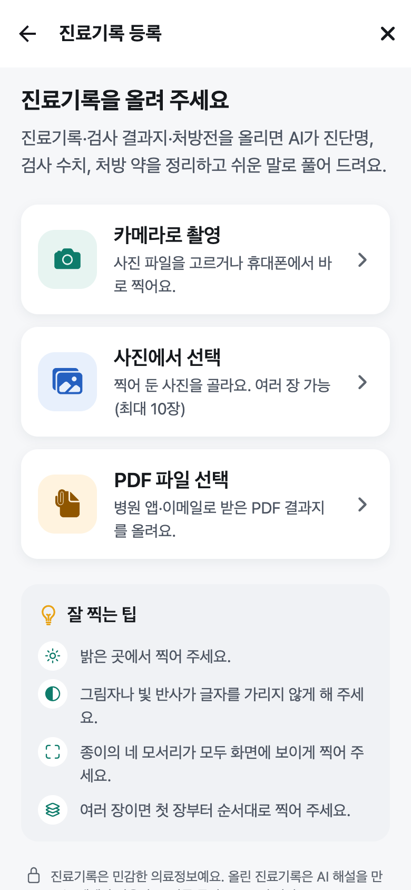 등록 방법 선택</td><td align="center">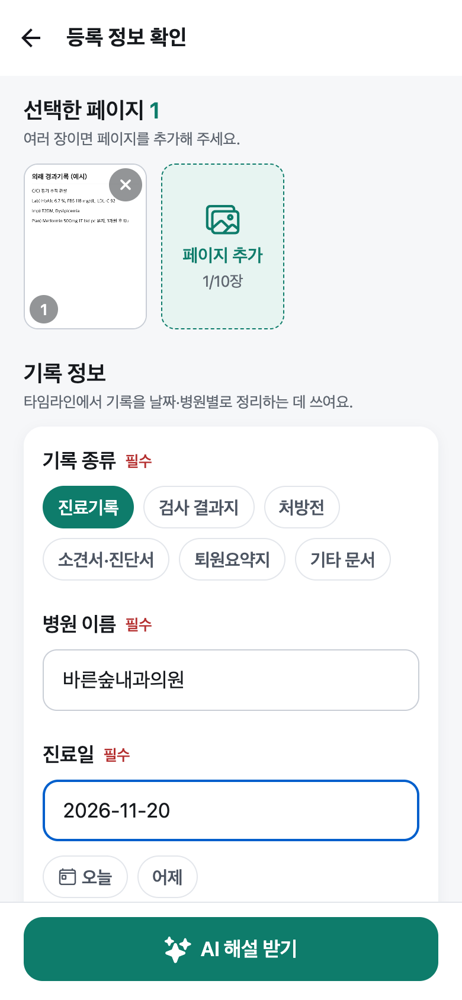 미리보기·정보 입력</td><td align="center">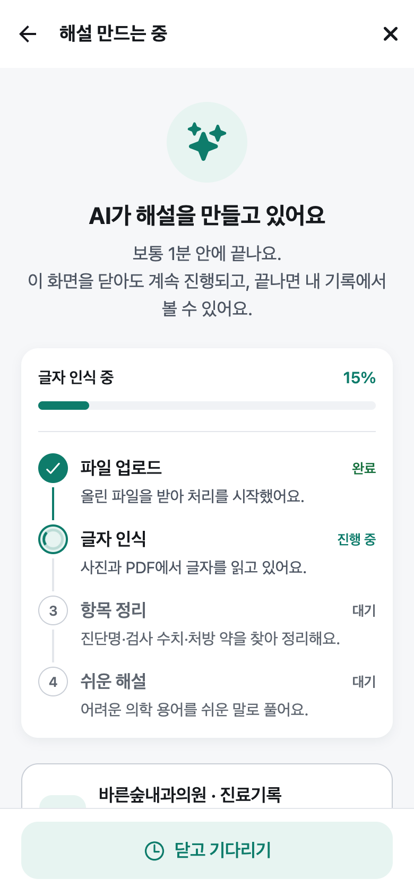 AI 처리 단계</td><td align="center">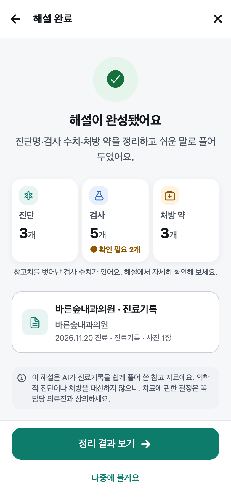 해설 완료</td></tr></table>

### ② 구조화 결과 — 진단명·검사 항목·처방 약물 항목별 화면

| 구분 | 내용 |
| --- | --- |
| 구현 내용 | • 기록 머리말(제목·기록 종류·병원·진료과·진료일·첫 페이지 미리보기·페이지 수)과 전체 요약, 진단·검사·처방 약 개수 요약 • **진단명**: 쉬운 진단명 + 원문 표기·질병 코드, 확진/의심/배제/과거력 구분, 쉬운 설명 • **검사 항목**: 수치·판정 요약, 검사 수치 화면으로 이동 • **처방 약물**: 제품명·성분, 한 번에 먹는 양·먹는 방법·처방 기간, 처방 원문, 주의사항 • 진단·검사·처방 약 각 항목에서 '원문 보기'로 근거 원문 문장으로 이동, AI 추천 질문 받기, 진료기록 삭제(헤더 휴지통) • 처리 중·분석 실패·조회 오류 상태를 공통 처리(`DocumentGate`) |
| 화면 | `src/app/documents/[id]/index.tsx` (상단 탭: 정리 결과 · 원문 대조 해설 · 검사 수치) |
| 주요 소스 | `src/components/result/*` · `src/components/domain/document-gate.tsx` · `src/components/domain/document-section-nav.tsx` |
| 검수 방법 | 1. 홈 › 최근 진료기록 또는 **내 기록** 탭에서 해설이 완료된 기록 선택 2. 진단명·검사 항목·처방 약 카드가 항목별로 나오는지, 의심 진단이 구분 표시되는지 확인 3. 항목의 **원문 보기** 를 눌러 원문 대조 해설의 해당 문장으로 이동하는지 확인 4. 헤더 휴지통 › 삭제 확인 → 내 기록·타임라인에서 사라지는지 확인 |

**화면** (웹 미리보기 캡처 · 가상 환자 샘플 데이터)

<table><tr><td align="center">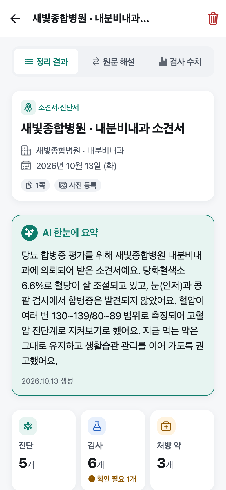 정리 결과 · AI 요약</td><td align="center">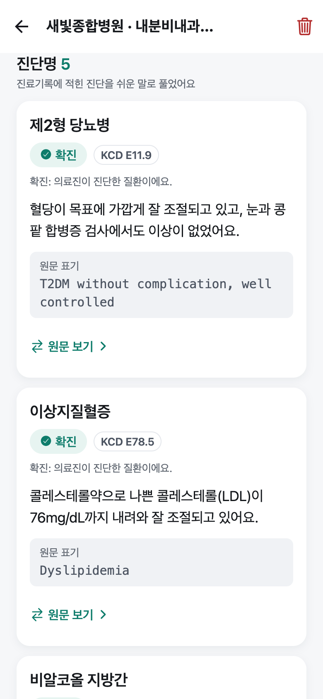 진단명 항목</td><td align="center">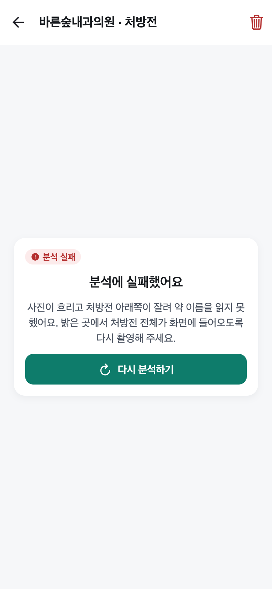 분석 실패 · 다시 분석</td></tr></table>

### ③ 원문 대조 해설 — 원문 문장과 환자 눈높이 해설을 나란히 표시

| 구분 | 내용 |
| --- | --- |
| 구현 내용 | • 진료기록 원문 문장과 쉬운 해설을 **나란히 / 위아래** 배치로 대조 (기본은 나란히, 설정 › 보기 설정 › '원문 대조 해설 배치'에서 변경). 두 단이 읽기 어려울 만큼 좁은 화면(폭 340pt 미만, 글자 크게 보기를 켠 380pt 미만)에서는 저장된 설정은 그대로 두고 자동으로 위아래로 보여 주며 '이렇게 읽어요' 안내에 이유를 표시 • 문장 속 의학 용어 강조 → 누르면 용어 풀이 • 원문 구역(진단·검사 결과·처방·향후 계획 등)별 보기 • AI 해설 신뢰도 0.7 미만 문장에 **'의료진 확인 권장'** 표시 • 글자 크게 보기, 관련 진단·검사·약 바로가기, 화면 하단 AI 해설 고지 |
| 화면 | `src/app/documents/[id]/explanation.tsx` |
| 주요 소스 | `src/components/explanation/*` · `src/store/settings.ts` (`largeText`, `explanationLayout`) |
| 검수 방법 | 1. 정리 결과 화면 상단 탭 **원문 대조 해설** 선택 2. 원문과 해설이 문장 단위로 짝지어 나오는지, 헤더 버튼으로 배치 전환(나란히/위아래)이 되는지 확인 3. 강조된 용어를 눌러 풀이가 열리는지, 구역별로 보기가 되는지 확인 4. **글자 크게** 를 켜면 해설 글자가 커지는지 확인 |

**화면** (웹 미리보기 캡처 · 가상 환자 샘플 데이터)

<table><tr><td align="center">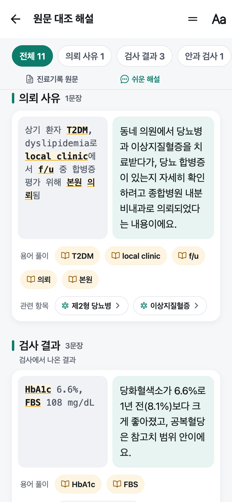 원문 ↔ 쉬운 해설 나란히</td><td align="center">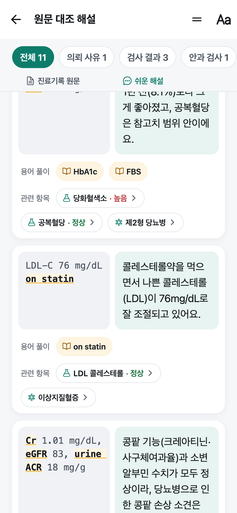 용어 풀이 · 관련 항목</td></tr></table>

### ④ 검사 수치 시각화 — 참고치 범위와 비교

| 구분 | 내용 |
| --- | --- |
| 구현 내용 | • **참고치 범위 막대**: 정상 구간과 측정값 위치를 그래픽으로 표시, 판정은 색 + 아이콘 + 글자(정상·높음·낮음·매우 높음/낮음)로 함께 표시 • 한쪽만 있는 참고치(예: `<100`)·범위를 크게 벗어난 값도 막대 안에 표시, 기준에서 벗어난 정도 문구 • 기록별 검사 수치: 정상·높음·낮음 개수 요약, '확인 필요' 필터, 분류별 묶음 • 내 검사 수치: 모든 기록의 검사 항목, 확인이 필요한 항목 먼저 • 수치 변화: 시간순 수치 변화 그래프(참고치 구간 표시), 지난 검사 대비 변화, 측정 기록 → 결과지, '이 검사에 대해 질문 추가' |
| 화면 | `src/app/documents/[id]/labs.tsx` · `src/app/labs/index.tsx` · `src/app/labs/[code].tsx` |
| 주요 소스 | `src/components/labs/*` (`range-bar.tsx`, `trend-chart.tsx` 등) · `src/lib/labs.ts` |
| 검수 방법 | 1. 진료기록 상단 탭 **검사 수치** 에서 막대 위 측정값 위치와 판정 글자 확인, '확인 필요' 필터 확인 2. 홈 › 확인이 필요한 검사 › **전체 보기** (또는 내 검사 수치)에서 항목 선택 3. 수치 변화 그래프·지난 검사 대비 변화·측정 기록이 나오는지 확인 → 측정 기록을 눌러 해당 결과지로 이동 |

**화면** (웹 미리보기 캡처 · 가상 환자 샘플 데이터)

<table><tr><td align="center">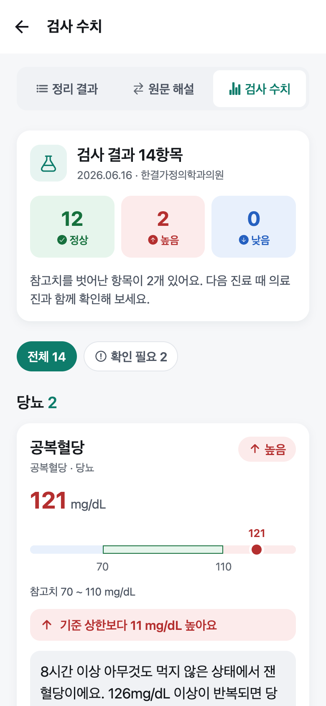 참고치 범위 막대</td><td align="center">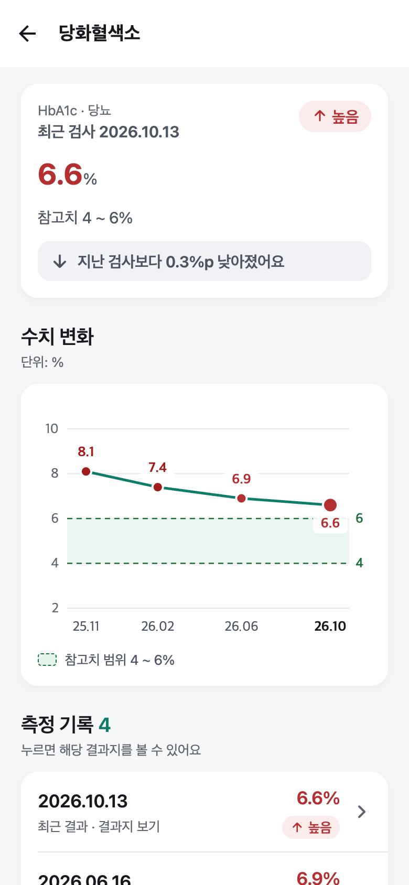 수치 변화 그래프</td><td align="center">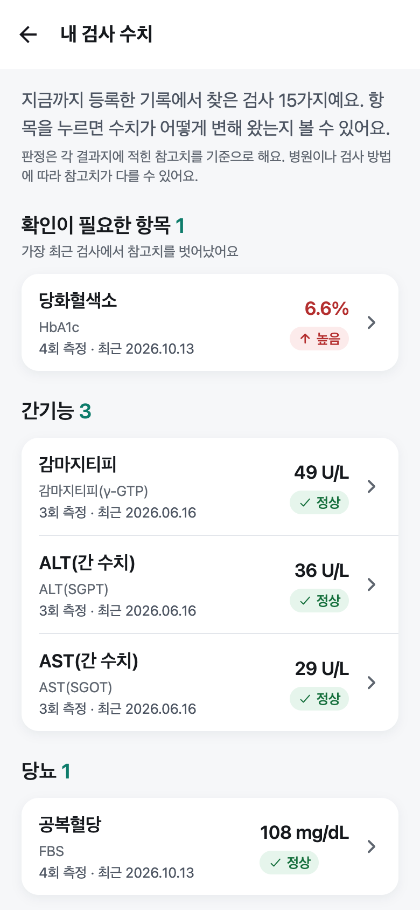 내 검사 수치</td></tr></table>

### ⑤ 질문 리스트·건강 타임라인

| 구분 | 내용 |
| --- | --- |
| 구현 내용 | **질문 리스트** • 정리 결과 화면에서 **AI 추천 질문 받기** → 질문 담기(이미 담은 질문은 제외) • 질문 직접 작성·수정·삭제, 관련 진료기록 연결, 의사 답변 메모 • 물어볼 질문 / 물어본 질문 / 전체 필터, 체크 한 번으로 '물어봤어요' (즉시 반영) • **진료실 모드**: 물어볼 질문을 큰 글씨 전체 화면으로 표시 **건강 타임라인** • 여러 기록의 진료·진단·검사·처방을 **월별로 시간순** 정리, 요약(기록 수·병원 수·기간) • 분류 필터(전체·진료·진단·검사·처방), 항목을 누르면 해당 기록의 정리 결과(검사는 수치 변화 또는 검사 수치)로 이동 |
| 화면 | `src/app/(tabs)/questions.tsx` · `src/app/questions/edit.tsx` · `src/app/(tabs)/timeline.tsx` |
| 주요 소스 | `src/components/questions/*` · `src/components/timeline/*` |
| 검수 방법 | 1. 해설이 완료된 기록의 정리 결과 › **AI 추천 질문 받기** › 질문 **담기** → **질문 노트** 탭에서 확인 2. **질문 쓰기** 로 직접 작성, 체크해 '물어본 질문'으로 이동하는지, 답변 메모 저장 확인 3. **진료실 모드** 를 열어 큰 글씨 화면 확인 4. **타임라인** 탭에서 월별 묶음·분류 필터 확인, 검사 항목의 **수치 변화 보기** 를 눌러 이동 |

**화면** (웹 미리보기 캡처 · 가상 환자 샘플 데이터)

<table><tr><td align="center">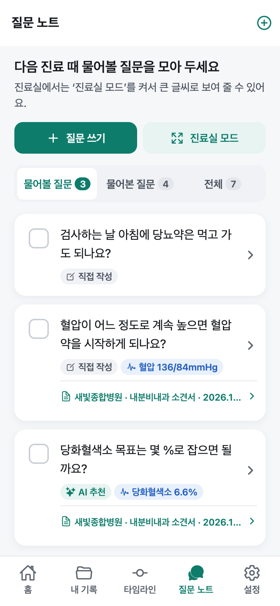 질문 노트</td><td align="center">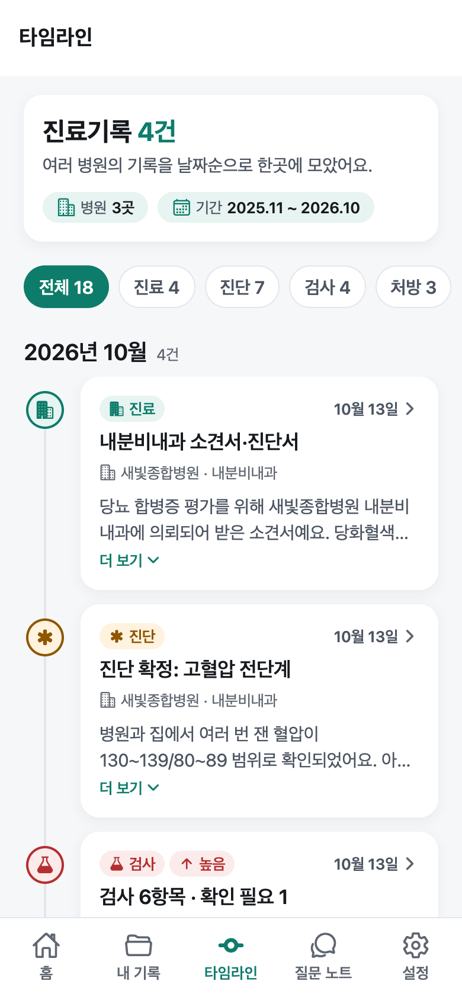 건강 타임라인</td></tr></table>

### ⑥ API 연동 — 백엔드·AI 해설 API 연동, 화면 상태 처리

| 구분 | 내용 |
| --- | --- |
| 구현 내용 | • API 계약 인터페이스 `ApiClient` (15개 엔드포인트) — 화면은 이 계약에만 의존 • `HttpApiClient`: REST 연동, `{data}` 래핑 허용, 오류를 `ApiError`(코드·환자용 문구·재시도 여부)로 정규화, 타임아웃, 업로드 진행률(XHR), 인증 토큰 주입 지점 • `MockApiClient`(내장 데모 서버): 같은 계약 구현, 기기 내 영구 저장, AI 처리 단계 시뮬레이션, 지연·오류 주입 • 화면 상태 일원화: 로딩 / 오류(다시 시도) / 빈 상태 / 처리 중(1.5초 폴링) / 분석 실패, 네트워크·서버 오류 자동 재시도(최대 2회), 변경 후 캐시 무효화, 질문 체크 낙관적 업데이트 • 이미 받은 내용이 있는 화면에서 새로고침만 실패하면 내용을 그대로 두고 상단에 '최신 내용을 불러오지 못했어요 · 다시 불러오기' 안내 (작성 중인 메모·진료실 모드·등록 진행 화면 유지, 홈은 섹션별로 같은 규칙) • 계약과 다른 응답(목록이 배열이 아님 등)은 서버 오류로 안내, 화면 렌더링 예외는 해당 화면만 오류 안내로 대체(앱 종료 방지) • 환경변수로 데모 서버 ↔ 실서버 전환, 설정 화면에 연결 상태 표시 (API 모드와 서버·AI 모델 버전은 개발·베타 빌드와 내장 데모 서버에서만 표시, 정식 빌드는 연결 상태만) • **제안 API 계약서**와 **OpenAPI 3.1 명세** 제공 |
| 화면 | 전 화면 공통 · `src/app/(tabs)/settings.tsx` (서비스 연결) |
| 주요 소스 | `src/api/*` · `src/api/mock/*` · `src/hooks/api.ts` · `src/components/states/*` · `src/app/_layout.tsx` (재시도 정책) |
| 문서 | [`docs/API_CONTRACT.md`](./API_CONTRACT.md) · [`docs/openapi.yaml`](./openapi.yaml) |
| 검수 방법 | 탭 화면은 한 번 열면 내용을 기억하므로 **탭을 오가기만 해서는 요청이 나가지 않습니다.** 아래처럼 실제로 요청이 나가는 동작으로 확인합니다. 1. 설정 › 서비스 연결에서 API 모드(데모)와 연결 상태 '정상' 확인 2. 설정 › 개발자 도구 › **응답 지연 3초** → **데모 데이터 초기화** → 곧바로 홈·내 기록·타임라인 탭을 열어 로딩 표시 확인 (또는 아직 열지 않은 진료기록을 열어 '진료기록을 불러오는 중이에요…' 확인) 3. **오류 발생률 50%** → 아직 열지 않은 진료기록을 여러 번 열어 본다 → 자동 재시도(최대 2회)까지 모두 실패하면 전체 오류 화면과 **다시 시도** (요청 3번이 모두 실패할 때라 몇 번 반복해야 할 수 있음) 4. 같은 설정에서 내 기록·타임라인을 **당겨서 새로고침** 반복 → 새로고침이 실패하면 목록은 그대로 두고 상단에 '최신 내용을 불러오지 못했어요 · 다시 불러오기' 안내 → 응답 지연 0.5초(기본값)·오류 발생률 0% 로 되돌림 5. **다음 업로드 분석 실패시키기** 를 켜고 진료기록 등록 → 실패 안내 확인 (이 설정은 1건에 적용되면 저절로 꺼짐) → **다시 분석하기** → 완료 확인 6. 코드 검수: `src/api/client.ts` 의 계약과 `docs/API_CONTRACT.md` 대조, `npm test` |

**화면** (웹 미리보기 캡처 · 가상 환자 샘플 데이터)

<table><tr><td align="center">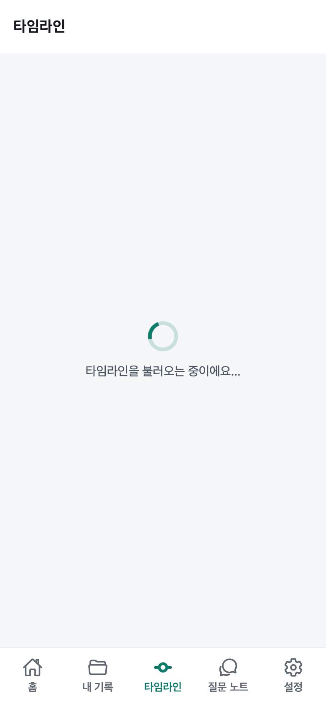 로딩 상태</td><td align="center">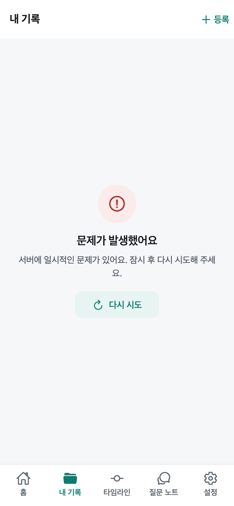 오류 · 다시 시도</td><td align="center">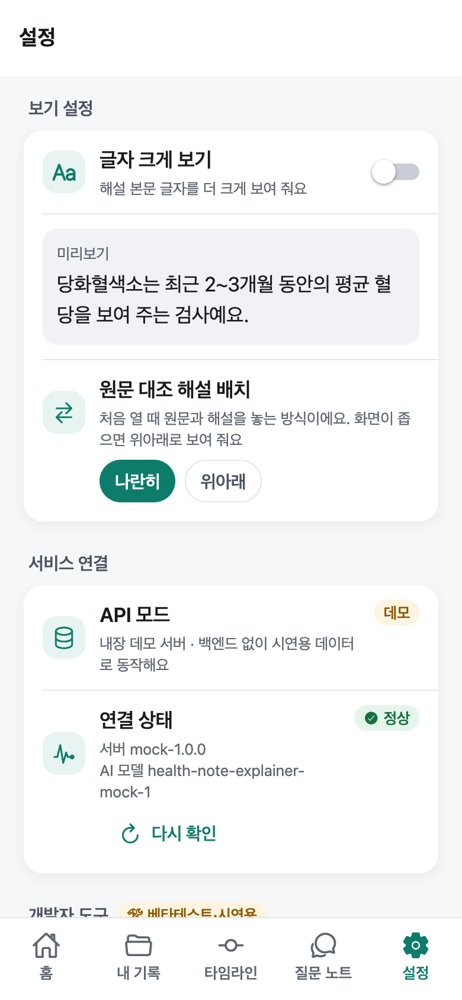 설정 · 서비스 연결</td></tr></table>

### ⑦ 테스트 빌드·오류 수정 — 베타테스트용 테스트 빌드 제작, 오류 수정 지원

| 구분 | 내용 |
| --- | --- |
| 구현 내용 | • EAS 빌드 프로필: `development`(개발 환경 표시 내부 빌드) · `preview`(내부 배포, Android APK / iOS ad hoc, 데모 서버) · `preview-api`(실서버 연동 베타) · `production` — 배포용 빌드는 서버 주소가 비었거나 자리표시자(example.com)면 설정 오류 화면을 띄우고 멈춤 • 빌드 스크립트: `npm run build:preview:android`, `npm run build:preview:ios` • 베타테스트 지원 도구(설정 › 개발자 도구, 데모 서버일 때만 표시): 응답 지연, 오류 발생률, 다음 업로드 분석 실패, AI 처리 시간, 데모 데이터 초기화 • 설정 › 정보: 앱 버전과 빌드 번호(`preview` 는 빌드마다 자동 증가, 예: `1.0.0 (7)`)·빌드 환경 표시 (오류 제보 시 확인), 문의 메일 주소(`EXPO_PUBLIC_SUPPORT_EMAIL`)를 지정하면 앱 버전이 미리 적힌 '메일로 문의하기' • 단위·통합 테스트(Jest) 및 정적 검사(TypeScript strict, ESLint) • 베타테스트 가이드: 빌드·설치·시연 시나리오·오류 재현·오류 제보 양식 |
| 설정·소스 | `eas.json` · `app.json` · `package.json` (scripts) · `src/components/settings/*` · `src/**/__tests__/*` |
| 문서 | [`docs/BETA_TEST_GUIDE.md`](./BETA_TEST_GUIDE.md) |
| 검수 방법 | 1. `npm run verify` (타입 검사 · 린트 · 테스트) 통과 확인 2. `eas build --profile preview --platform android` 로 APK 생성 → 설치 링크로 기기 설치 → 베타테스트 가이드의 시연 시나리오 수행 3. 설정 › 정보에서 앱 버전·빌드 번호·빌드 환경(예: `1.0.0 (7)` · 베타테스트) 확인 4. 만든 테스트 빌드는 [베타테스트 가이드 1.6 빌드 기록](./BETA_TEST_GUIDE.md#16-빌드-기록)에 빌드 ID·버전·설치 링크를 남긴다 |

---

## 2. 납품물 목록

| 구분 | 납품물 | 위치 |
| --- | --- | --- |
| 소스코드 | 앱 소스 (화면·컴포넌트·API 계층·데모 서버·상태·유틸·타입) | `src/` |
| | 앱 아이콘·스플래시 이미지 | `assets/` |
| | 앱 설정 (앱 이름 '건강수첩', 번들 ID `kr.goldentime.healthnote`, 권한 안내 문구) | `app.json` |
| | 의존성·스크립트, 잠금 파일 | `package.json`, `package-lock.json` |
| | 개발 도구 설정 (TypeScript · ESLint · Jest) | `tsconfig.json`, `eslint.config.js`, `jest.setup.ts` |
| 빌드 설정 | EAS 빌드 프로필 | `eas.json` |
| | 환경변수 예시 | `.env.example` |
| 테스트 | API 계층: HTTP 클라이언트·오류 정규화·설정 | `src/api/__tests__/` |
| | 내장 데모 서버: 처리 파이프라인·질문·검사 집계·타임라인·영구 저장 | `src/api/mock/__tests__/` |
| | 유틸·스토어·훅: 날짜·검사 수치 계산·라벨, 설정·진료기록 등록 상태, 서버 데이터 훅·오늘 날짜 | `src/lib/__tests__/`, `src/store/__tests__/`, `src/hooks/__tests__/` |
| | 공통 UI·화면별 로직·컴포넌트·통합 흐름 (등록·결과·해설·검사·질문·기록·타임라인·설정·온보딩) | `src/components/*/__tests__/` |
| 문서 | 프로젝트 소개·실행·빌드 | `README.md` |
| | 납품 내역서 (본 문서) | `docs/DELIVERABLES.md` |
| | API 계약서 (제안안) · OpenAPI 3.1 명세 | `docs/API_CONTRACT.md`, `docs/openapi.yaml` |
| | 베타테스트 가이드 | `docs/BETA_TEST_GUIDE.md` |
| | 개발 가이드 (코드 컨벤션) | `docs/DEVELOPMENT.md` |
| | 변경 이력 | `CHANGELOG.md` |
| | 화면 캡처 (과업별 주요 화면 20장, 웹 미리보기) | `docs/screenshots/` |

> 설치 파일(APK·IPA)은 저장소에 포함하지 않습니다. `eas.json` 의 `preview` 프로필로 언제든 다시 만들 수 있으며, 절차는 베타테스트 가이드에 있습니다.
> EAS 빌드는 발주처 명의의 Expo 계정(프로젝트 ID `extra.eas.projectId`)과 서명 키로 만들어야 하므로(4. 제약 및 전제사항 5), 제작한 빌드의 ID·버전·설치 링크는 [베타테스트 가이드 1.6 빌드 기록](./BETA_TEST_GUIDE.md#16-빌드-기록)에 기록합니다.

---

## 3. 검수 체크리스트

### 기능

- [ ] 온보딩: 안내를 넘기고 필수 동의 후 시작, 설정 › 처음 안내 다시 보기
- [ ] ① 촬영·사진(여러 장)·PDF로 등록, 페이지 추가·빼기·순서 변경, 필수 입력 검증
- [ ] ① 업로드 진행률과 AI 처리 단계 표시, 완료 후 정리 결과 보기
- [ ] ① 분석 실패 안내와 다시 분석하기
- [ ] ② 진단명·검사 항목·처방 약물이 항목별로 표시되고 '원문 보기'로 이동
- [ ] ② 진료기록 삭제 후 목록·타임라인에서 제외
- [ ] ③ 원문 문장과 쉬운 해설 대조(나란히/위아래), 용어 풀이, 의료진 확인 권장 표시, 글자 크게
- [ ] ④ 참고치 막대에 측정값·판정(색+글자) 표시, 내 검사 수치, 수치 변화 그래프
- [ ] ⑤ AI 추천 질문 담기, 질문 작성·수정·삭제, 물어봤어요 체크, 답변 메모, 진료실 모드
- [ ] ⑤ 타임라인 월별 묶음·분류 필터·상세 이동
- [ ] 홈 요약(처리 상태 알림·최근 기록·확인이 필요한 검사·물어볼 질문), 내 기록 검색·필터·정렬

### 화면 상태·API 연동

- [ ] 로딩 표시 (개발자 도구 › 응답 지연 3초 → 데모 데이터 초기화 또는 아직 열지 않은 기록 열기)
- [ ] 오류 화면과 다시 시도 (개발자 도구 › 오류 발생률 → 아직 열지 않은 기록 열기), 새로고침 실패 시 내용 유지 + 상단 안내
- [ ] 온보딩 동의 전에는 딥링크·웹 주소(`/upload` 등)로 들어와도 동의 화면으로 이동
- [ ] 빈 상태 안내 (개발자 도구 › 데모 데이터 초기화 후 진료기록·질문 삭제)
- [ ] 처리 중 자동 갱신, 처리 완료 시 목록·타임라인 반영
- [ ] 설정 › 서비스 연결: 연결 상태 (API 모드·서버/AI 모델 버전은 개발·베타 빌드와 데모 서버에서만)
- [ ] API 계약서와 `src/api/client.ts` 계약 일치

### 품질·빌드

- [ ] `npm run typecheck` · `npm run lint` · `npm test` 통과
- [ ] iOS · Android · 웹에서 실행
- [ ] 스크린리더로 주요 버튼 이름 읽힘, 판정이 색 외에 글자·아이콘으로도 구분
- [ ] `preview` 프로필로 Android APK 빌드·설치

---

## 4. 제약 및 전제사항

1. **API·디자인 미제공** — 과업 수행 기간 중 발주처로부터 백엔드·AI 해설 API와 화면 디자인을 제공받지 못했고 추가 질의도 불가능했습니다. 이에 따라
   - 화면 요구사항에서 필요한 데이터를 도출해 **제안 API 계약**(`docs/API_CONTRACT.md`, `docs/openapi.yaml`)을 작성했고,
   - 같은 계약을 구현한 **내장 데모 서버**로 모든 화면과 상태(처리 중·실패·오류 포함)를 시연·베타테스트할 수 있게 했으며,
   - 디자인은 의료 정보 앱에 맞춘 자체 디자인 토큰(`src/constants/theme.ts`)으로 구성했습니다.
2. **실서버 연동** — 백엔드가 계약을 준수하면 환경변수(`EXPO_PUBLIC_API_MODE=http`, `EXPO_PUBLIC_API_BASE_URL`)만 바꿔 즉시 연동됩니다. 계약과 다른 경우 `src/api/http-client.ts` 의 매핑만 수정하면 되며 화면 코드는 바뀌지 않습니다.
3. **AI 해설 내용** — 데모 서버의 해설은 시연용 샘플입니다. 실제 글자 인식(OCR)·구조화·해설 생성은 발주처의 AI 해설 API 범위입니다.
4. **인증·회원** — 과업 범위에 포함되지 않았습니다. 실제 환자 데이터를 다루기 전 인증·사용자별 데이터 분리·전송/저장 암호화 등 개인정보(민감정보) 보호 조치와 관련 법령 검토가 필요합니다. 인증 토큰 주입 지점은 마련되어 있습니다(`HttpApiClient` `getAuthToken`).
5. **배포 계정·서명 키** — 앱 스토어 배포와 iOS 테스트 빌드에는 Apple Developer Program·Google Play Console 계정, Expo(EAS) 계정, 앱 서명 키가 필요하며 **발주처 명의로 소유·관리**해야 합니다. 번들 ID(`kr.goldentime.healthnote`)는 출시 전 발주처가 확정합니다.
6. **웹** — 웹 빌드는 시연용입니다. 카메라 촬영은 브라우저의 파일 선택으로 대체되며, 데모 데이터는 브라우저 저장소에 보관됩니다.
7. **권리 귀속** — 납품물의 권리 귀속과 이용 범위는 용역 계약서에 따릅니다.
